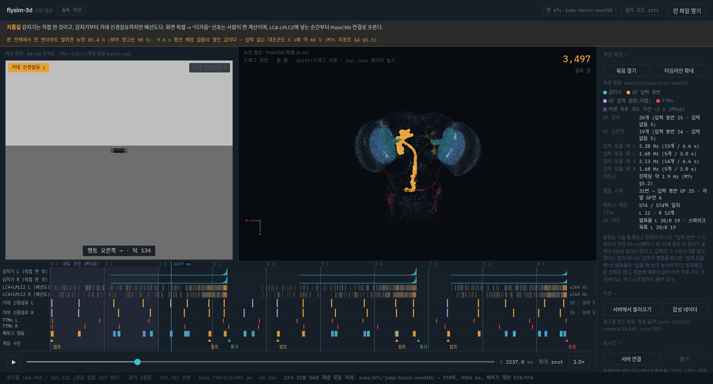
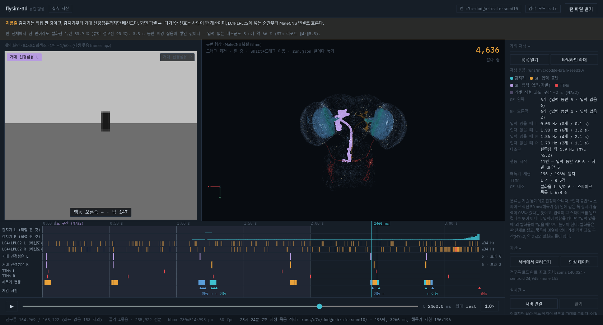
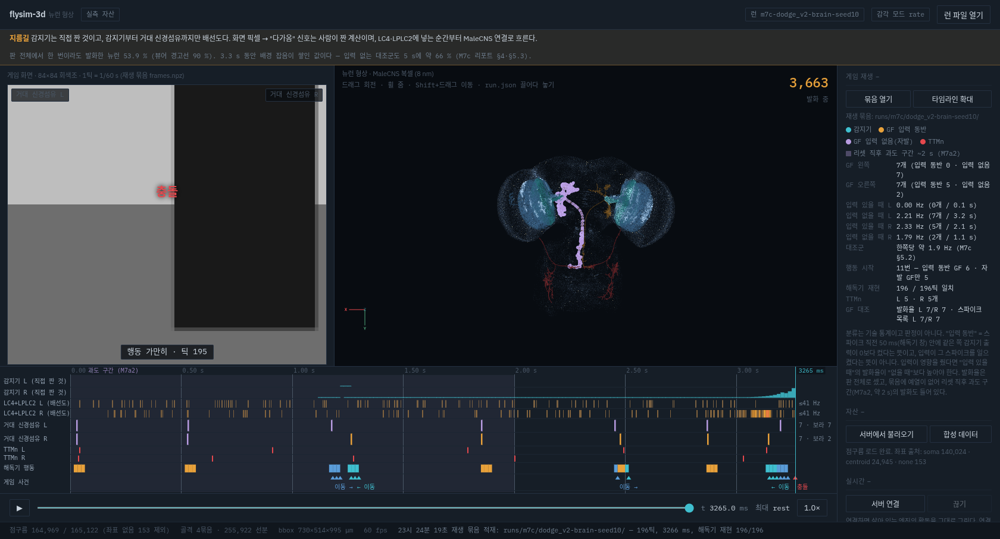

# M7e 보고서 — 분할 화면 재생기: 왼쪽 게임, 가운데 3D 초파리 뇌, 아래 타임라인

조종석 창, 2026-10-23. 사양: `docs/m7e-brief.md`. 배경: `docs/m7-game-ladder.md`(규칙, "M7e 준비 결정", M7a2 결과),
`docs/m7c-report.md`(재생 묶음 형식과 결과). 바뀐 파일: `flysim-3d.html`, `tests/test_3d_html.py`, 이 보고서, 스크린샷 세 장.

**이 화면은 M7c의 결과("초파리는 무작위와 구별 안 됨")를 바꾸지 않는다. 그 결과가 화면에서 어떻게 생겼는지를 보여줄 뿐이다.**

## 1. 정한 것 두 가지

| 질문 | 결정 | 근거 |
|---|---|---|
| 파일 형태 | `flysim-3d.html`의 **"게임 재생" 모드** | 렌더러를 두 벌 만들지 않는다(M6d 원칙). 점구름·골격·잔광·카메라를 그대로 쓰고, 묶음을 열면 화면이 셋으로 갈린다. WebGL2 컨텍스트는 여전히 하나다(테스트로 고정). |
| 프레임 읽기 | **`frames.npz`를 브라우저에서 직접 푼다** | 세 묶음 모두 표준 zip, deflate, zip64 아님이라 `DecompressionStream("deflate-raw")`로 풀린다. zip 레코드와 `.npy` 머리를 직접 해석한다(외부 스크립트 없음). 생산 쪽에 원시 이진을 추가해 달라고 할 필요가 없었다. |

생산 쪽 형식이 바뀌면 브라우저보다 먼저 테스트가 깨지게 했다 — 실제 묶음의 zip 방식·zip64 여부·dtype이 파서가 아는 범위인지 검사한다(`test_real_bundles_fit_the_browser_parser`).

## 2. 화면

- **머리 띠(지름길 표시, 필수)**: "감지기는 직접 짠 것이고, 감지기부터 거대 신경섬유까지만 배선도다." 그 아래에 판 전체 발화 비율과 그 설명.
- **왼쪽 게임 창**: 84×84 회색조 프레임을 픽셀 그대로 확대. 위 양쪽에 **거대 신경섬유 램프** — 해독기가 보는 창(직전 50 ms)에 그 쪽 스파이크가 있으면 켜지고, 같은 쪽 감지기 입력이 있던 때면 주황, 없던 때면 보라. 아래에 지금 틱의 행동, 가운데에 최근 사건(점프·이동·통과·충돌), 밑에 감지기 좌·우 출력 막대. 그 아래 머리 정보: 게임, 점수, 에이전트, 시드, `k`, 동작점(g · σ · 적응 g_b), 프로필, 해독기 규칙, 길이, 판 끝, 감각 모드.
- **가운데 3D 뇌**: escape 프로필 골격 네 묶음(LC4 83,385 · LPLC2 167,149 · DNp01 3,781 · TTMn 1,607 선분)을 겹쳐 그리고, 골격을 가진 뉴런이 발화하면 **그 뉴런의 가지만** 밝게 다시 그린다(계약의 `seg_offset`/`seg_count`). 거대 신경섬유와 운동뉴런은 같은 꼭짓점을 굵은 점으로도 그려 뇌에서 신경삭까지 번쩍인다. 색은 주황(입력 동반) / 보라(입력 없음) / 빨강(TTMn).
- **아래 타임라인(판 전체 또는 ±1.5 s 확대)**: 감지기 L·R(직접 짠 것) → LC4+LPLC2 L·R 집단 발화율(배선도) → 거대 신경섬유 L·R 스파이크(주황/보라) → TTMn L·R → 해독기 행동 → 게임 사건. 클릭·드래그로 그 시각으로 간다. 처음 약 2 s는 **리셋 직후 과도 구간(M7a2)** 으로 옅은 보라 띠를 칠했다.
- **오른쪽 통계**: 아래 4절의 표에 있는 값들.

## 3. 시간 정렬 — 하네스와 같은 규칙, 그리고 검증

하네스(`flysim/apps/games/brain.py`, `m7c.py`)의 시각 규칙을 그대로 따랐다.

- 틱 k의 프레임은 `t_ms[k]`에 보이고, 감지기 출력 `loom[k]` × k가 틱 k 동안 같은 쪽 LC4·LPLC2 전부에 들어간다.
- 틱이 끝나는 시각 e_k에서 해독기가 [e_k − 50 ms, e_k)의 거대 신경섬유 스파이크로 `actions[k]`를 정한다(양쪽 → 점프, 왼쪽만 → 오른쪽, 오른쪽만 → 왼쪽).
- 화면은 현재 시각 이하의 마지막 게임 프레임을 띄운다. 3D와 타임라인은 같은 1 ms 시계를 쓴다.
- 거대 신경섬유 스파이크는 run.json의 **1개짜리 escape 영역 발화율**에서 센다(표본 상한과 무관, 준비 결정 3). 스파이크 목록에서 센 수와 비교해 화면에 함께 적었다 — 세 묶음 모두 일치.

**검증: 이 규칙으로 해독기를 다시 돌리면 기록된 행동이 전부 나온다.** 브라우저에서 뛰어넘기 574/574틱, 피하기 196/196, 피하기 v2 196/196 일치. 같은 규칙을 파이썬으로 다시 짠 테스트(`test_time_alignment_reproduces_the_recorded_actions`)도 세 묶음에서 통과한다. 정렬이 한 틱이라도 어긋났다면 이 수가 깨진다.

## 4. 세 묶음에서 화면이 보여 주는 것

| | 뛰어넘기 | 피하기 v1 | 피하기 v2 |
|---|---|---|---|
| 길이 · 틱 | 9,566 ms · 574 | 3,266 ms · 196 | 3,266 ms · 196 |
| 점수 · 판 끝 | 2 · 충돌, `other:no_reaction` | 0 · 충돌, `late` | 0 · 충돌, `late` |
| 거대 신경섬유 L (입력 동반 / 입력 없음) | 20 (15 / 5) | 6 (0 / 6) | 7 (0 / 7) |
| 거대 신경섬유 R | 19 (14 / 5) | 6 (4 / 2) | 7 (5 / 2) |
| L 발화율: 입력 있을 때 / 없을 때 | 2.28 / 1.68 Hz | — (왼쪽 입력 0.1 s) / 1.90 Hz | — / 2.21 Hz |
| R 발화율: 입력 있을 때 / 없을 때 | 2.13 / 1.68 Hz | 1.86 / 1.79 Hz | 2.33 / 1.79 Hz |
| 행동 시작 (입력 동반 GF / 자발 GF만) | 31 (25 / 6) | 11 (6 / 5) | 11 (6 / 5) |
| TTMn L / R | 12 / 12 | 4 / 5 | 5 / 5 |
| 해독기 재현 | 574 / 574 | 196 / 196 | 196 / 196 |
| 판 전체 발화 뉴런 | 85.4 % | 53.9 % | 53.9 % |

**읽는 법 (기술이고 판정이 아니다).** "입력 동반"은 스파이크 직전 50 ms 안에 같은 쪽 감지기 출력이 0보다 컸다는 뜻이지, 입력이 그 스파이크를 일으켰다는 뜻이 아니다. 뛰어넘기에서는 감지기가 판의 3분의 2 동안 켜져 있어 대부분의 스파이크가 우연히 "동반"으로 분류된다. 그래서 **입력이 있을 때와 없을 때의 발화율을 나란히** 놓았다. 세 묶음 모두 그 차이가 0.6 Hz 이내이고 둘 다 대조군의 한쪽당 약 1.9 Hz(M7c §5.2) 근처다. 이것은 M7c의 "장애물당 스파이크 수는 배경 수준"과, M7a2의 "접근 한 번에 +1발 대 창당 배경 약 0.65발"과 같은 그림이다.

피하기 두 게임에서는 장애물 반대쪽 감지기가 판 내내 사실상 0인데도 그 쪽 거대 신경섬유가 6~7번 쏘았고, 그때마다 해독기는 **장애물 쪽으로** 움직였다. 화면에서 "행동이 잡음을 따랐다"가 생긴 모양이 이것이다(두 번째 스크린샷).

**판 전체 발화 비율.** 뛰어넘기 85.4 %는 뷰어 경고선 90 %에 가깝다. 머리 띠에 "9.6 s 동안 배경 잡음이 쌓인 값이다 — 입력 없는 대조군도 5 s에 약 66 %(M7c 리포트 §4·§5.3)"를 함께 띄우고, 75 % 이상이면 주황으로 강조한다. 90 %를 넘는 묶음이 오면 뷰어의 실패 문구를 그 앞에 그대로 붙인다.

## 5. 스크린샷 (헤드리스 Chrome, RTX 4090, 1680×1050)

정적 서버로 연 실제 묶음이다. 각 장면은 멈춘 화면이고, 멈춘 화면은 그 순간의 모습을 유지한다(아래 7절).

**① 뛰어넘기, 2,237 ms — 입력이 있을 때의 왼쪽 거대 신경섬유 발화.** 장애물이 멀리 보이고 감지기가 켜진 구간이다. 왼쪽 거대 신경섬유(주황)가 뇌에서 신경삭까지 켜졌고, 해독기는 한쪽만 켜졌으므로 "오른쪽 →"을 냈다. 이 게임에서 좌우 이동은 아무 효과가 없으므로(`flysim/apps/games/jump.py`) 이 발화는 판에 영향이 없다. 넘으려면 양쪽이 같이 쏘아 점프가 나와야 한다.



**② 피하기 v1, 2,460 ms — 입력이 없는 쪽의 자발 발화가 행동을 정한 순간.** 과도 구간이 끝난 정상 상태다. 기둥은 오른쪽에서 다가와 오른쪽 감지기만 켜져 있는데, 입력이 없는 **왼쪽** 거대 신경섬유가 자발로 쏘았다(보라). 해독기는 "오른쪽 →", 즉 기둥 쪽으로 움직였다.



**③ 피하기 v2, 3,265 ms — 판 끝.** 기둥이 화면을 덮고 "충돌"이 뜬다. 판 끝 정보는 `game.json`의 `crash` 사건과 `loss_cause = late`에서 온다. 타임라인에서 좌우 거대 신경섬유가 번갈아 쏘고 행동이 양쪽으로 갈리는 것이 보인다(M7c §5.1의 "순이동 없음").



## 6. 여는 법

엔진 서버 없이 정적 서버로 연다. 저장소 루트에서:

```
python3 -m http.server 8000
```

```
http://127.0.0.1:8000/flysim-3d.html?bundle=runs/m7c/jump-brain-seed10/&assets=data/cache/
```

- `?assets=data/cache/` 는 점구름과 골격을 계약의 디스크 파일 이름(`neurons-3d.*`, `skel-<name>.*`)으로 읽게 한다. 이때는 골격 목록 파일이 없으므로 **재생 중인 run.json의 집합(LC4·LPLC2·DNp01·TTMn)이 읽을 묶음을 정한다.** 엔진 서버(`python -m flysim.live.server`)로 열면 지금처럼 `/neurons-3d.*`·`/skel/*` 엔드포인트를 쓴다.
- 묶음은 "게임 재생 → 묶음 열기"로 세 파일을 함께 고르거나 창에 끌어다 놓아도 된다.
- `?assets=`와 `?bundle=`은 같은 서버의 상대 경로만 받는다(`..`나 다른 출처 거부).
- 묶음을 다시 만드는 명령: `python -m flysim.apps.games.m7c --bundles-only` (서버 창).

## 7. 함께 바뀐 동작 (게임 모드 밖에도 영향)

1. **집합 소속은 run.json에서 온다** (준비 결정). `neurons.region`/`regions`가 있으면 그것으로 점구름 색과 집합 목록을 바꾸고, 없거나 길이가 안 맞으면 점구름의 `set` 배열(기본값)로 돌아간다. 기존 청각 런(`runs/m3-click-rate`)을 열면 같은 15집합이 run.json에서 나오는 것을 확인했다.
2. **멈춘 화면은 그 순간을 유지한다.** 전에는 정지해도 잔광이 계속 꺼져 화면이 비었다. 이제 재생 중이거나 실시간일 때만 감쇠하고, 스크럽·화살표·타임라인 클릭은 그 시각의 화면을 지난 120 ms의 스파이크로 다시 만든다. 2D 재생기가 정지 중 다시 그리지 않는 것과 같은 성질이다.
3. **`hidden` 속성 결함 수정.** `.conn{display:flex}`가 `hidden`을 덮어, 실시간이 아닌데도 상단에 "● 연결 안 됨"이 계속 떠 있었다(M6d부터). `[hidden]{display:none!important}` 한 줄로 고쳤고 테스트로 막았다.

## 8. 테스트

`tests/test_3d_html.py` 59 → **84**, `pytest tests/` **439 passed**. 새 검사는 하네스 파일을 직접 읽어 대조한다:

- 행동 이름 순서 = `flysim/apps/games/base.py`의 `Action`, 해독 창 = `brain.py`의 `DECODER_WINDOW_MS`, 해독 규칙 = `probe/motor.py`, 사건 종류 ⊇ `m7c.py`가 내는 것, escape 집합마다 색이 있음(`probe/sets.py`).
- 실제 묶음이 있으면(`runs/`는 git 밖) 파서 가정 검사와 **행동 재현 검사**를 세 묶음에 대해 돌린다. 없으면 건너뛴다.
- 지름길 문구, 자발 발화 표시, "동반 ≠ 원인" 문구와 입력 유무 발화율, 판 끝을 지어내지 않음, 판 전체 발화 비율 설명, 렌더러 한 벌, 경로 탈출 거부.

## 9. 생산 쪽과 주고받은 것

- **충돌 사건이 묶음에서 빠지던 결함**을 찾아 보고했다(직접 고치지 않음). `m7c.py`의 `t_ms < dur`가 마지막 틱의 충돌(`t_ms == dur`)을 걸렀다. 서버 창이 f9b060e로 고쳐 `crash` 사건과 `crashed`·`loss_cause`를 넣었고, 프레임과 run.json은 바이트 동일하다. 재생기는 고치기 전에도 "판 종료 — game.json에 종료 사유 없음"으로 표시하고 충돌을 지어내지 않게 만들었다.
- 그 사건은 판 길이와 같은 시각에 찍히는데 재생 시계의 마지막 빈은 1 ms 앞이라, 마지막 빈에서는 판 끝 시각까지의 사건을 보게 했다(③번 스크린샷의 "충돌").

## 10. Deviations

1. **과도 구간 띠는 문서 값이다.** "약 2 s"는 M7a2가 적은 값이고 이 화면이 잰 값이 아니다. 묶음에 예열이 없어 처음 2 s의 발화(예: 피하기 0.53 s에 양쪽이 같이 쏜 점프)는 정상 상태의 배경과 다르므로 따로 칠했다. 통계의 발화율은 판 전체로 셌고 이 구간을 빼지 않았다(주석에 명시).
2. **"입력 동반"의 창을 해독기 창(50 ms)과 같게 잡았다.** 입력의 영향을 판정하는 규칙이 아니라 화면에서 두 사건이 얼마나 가까운지를 고르는 기준이다. 그래서 발화율 비교를 함께 둔다.
3. **골격 번쩍임의 감쇠는 반감기 90 ms(벽시계)** 로 정했다. 시각 표현일 뿐 모델 값이 아니다.
4. **사건 표시 창 350 ms**, 타임라인 확대 ±1.5 s도 표시용으로 정한 값이다.

## 11. 한계

- **실시간형은 아직 없다.** 재생형만이다(준비 결정 4). 게임 프레임을 웹소켓으로 보내는 메시지가 프로토콜에 없다.
- 판 전체 발화 비율은 run.json의 `active_neurons`를 그대로 쓴다. 창별 비율은 묶음에 없어 화면이 다시 세지 않는다.
- 피하기 두 묶음은 판이 첫 기둥에서 끝나 3.3 s뿐이다. 과도 구간이 판의 60 %를 차지하므로 이 두 판의 "입력 없을 때" 발화율은 정상 상태 값보다 과도 구간의 영향을 많이 받는다.
- 1 ms 빈 하나에 같은 거대 신경섬유가 두 번 쏘는 일은 불응기 2 ms 때문에 없지만, 묶음 형식이 바뀌어 빈이 넓어지면 램프와 분류가 빈 안의 순서를 구분하지 못한다.
