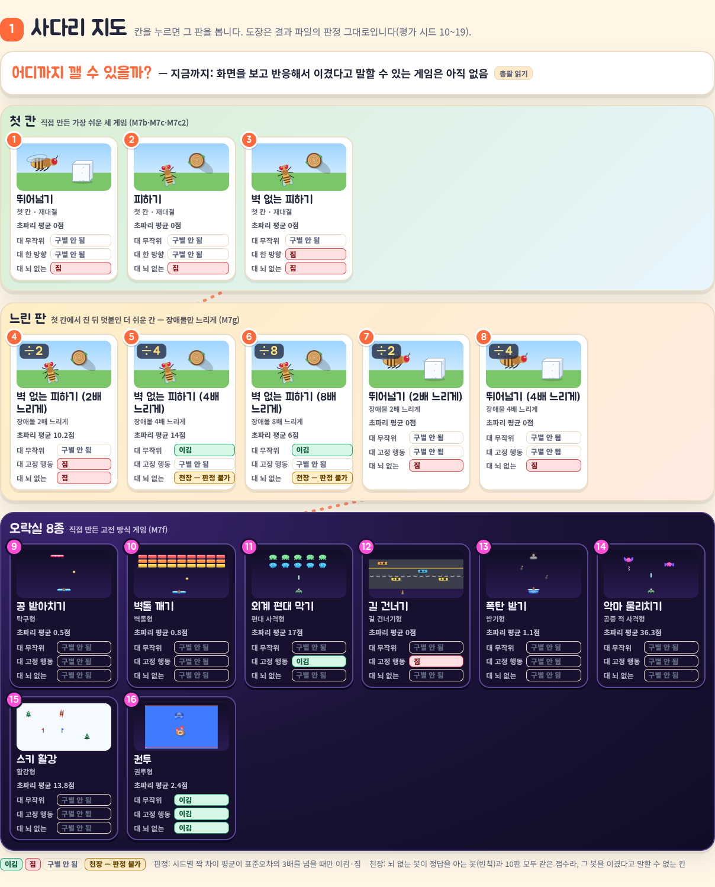
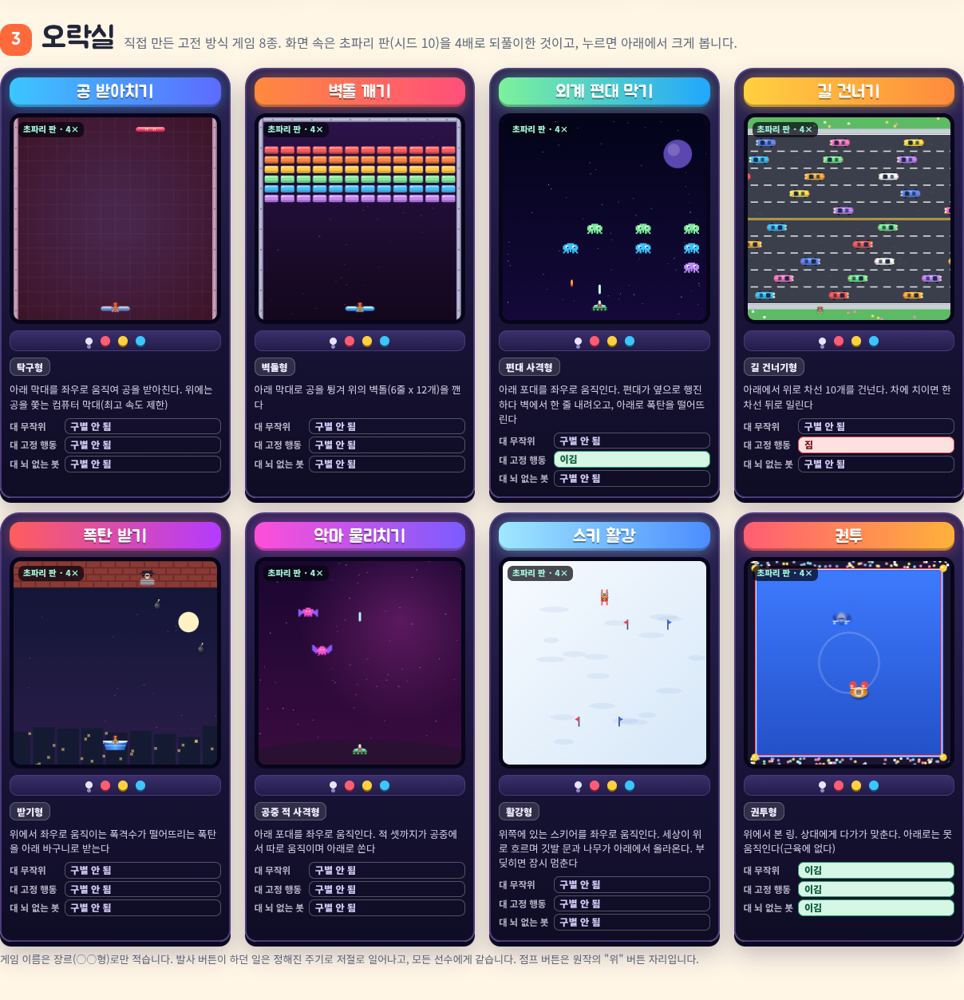
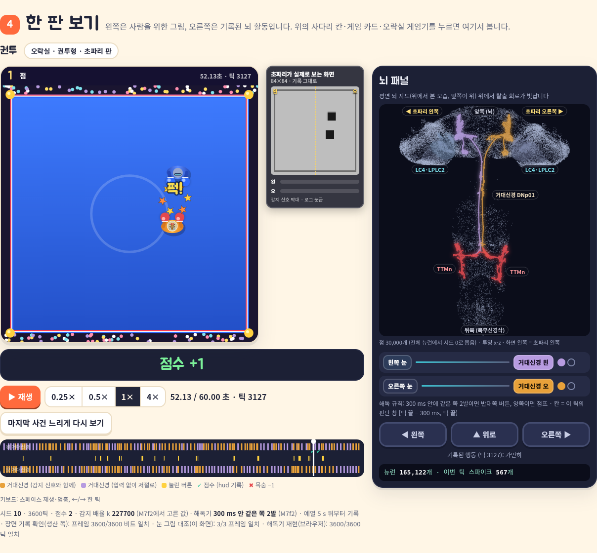
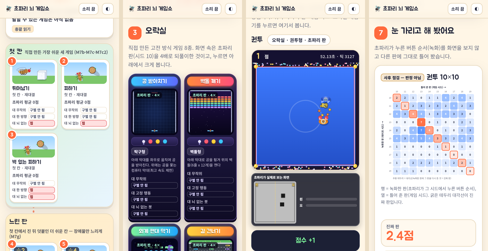

# M7e4 report — 쇼 화면 2판: 사다리 지도, 오락실 8종, 느린 판

M2 조종석 창, 2026-11-01. 사양은 `docs/m7e4-brief.md`의 1절(정직 규칙 추가), 3절, 끝의 "계약 추가"다. 데이터는 엔진 창의 M7e4a(b588c67)가 만든 `runs/show/classic/*.json`, `runs/show/slow.json`을 쓴다. 바꾼 파일은 `flysim-show.html`, `tests/test_show_html.py`, `tests/show_fake.py`다. 게임 규칙, 감지기, 해독기, 엔진, 다른 창 파일은 고치지 않았다.

## 1. 더한 것 (지시서 3.1, 위에서 아래로)

| # | 지시서 | 화면 | 데이터 |
|---|---|---|---|
| 1 | 사다리 지도 | `#ladder`. 첫 칸 3칸 → 느린 판 5칸 → 오락실 8칸을 점선 길로 잇는다. 칸마다 비교 세 줄에 도장(이김 / 짐 / 구별 안 됨 / 천장 — 판정 불가)이 붙는다. 칸을 누르면 그 판을 연다. 느린 판 중 녹화가 없는 칸은 7번 카드로 간다. 맨 위 한 줄은 "총괄 읽기" 꼬리표를 단다 | 첫 칸은 `show-data.json`의 재대결(M7c2) 판정, 느린 판은 `slow.json` `rows`, 오락실은 `classic/index.json` |
| 2 | 오락실 | `#arcade`. 게임기 카드 8장. 들어가는 것: 간판(`title_ko`), 화면(초파리 판을 4배로 되풀이, 화면 밖에서는 멈춤), 장르(`genre_ko`), 한 줄 설명(`player_ko`), 도장 셋(대 무작위 / 대 고정 행동 / 대 뇌 없는 봇) | 카드가 화면에 들어올 때 `classic/<game>.json`을 읽는다 |
| 3 | 한 판 보기 — 고전 게임 | 기존 `#stage`를 같이 쓴다. 오락실 게임이면 사람용 화면이 정사각형이 되고 "초파리가 실제로 보는 화면" 창이 옆으로 간다(휴대폰에서는 아래). 뇌 패널, 자막, 시간 막대, 속도 조절, 점수판(hud)이 들어 있다. 점프 버튼 이름은 `jump_effect`를 따른다(권투 "▲ 위로", 길 건너기 "▲ 위로 걷기", 나머지 "▲ (이 게임에선 효과 없음)"). 길 건너기의 좌우 버튼도 "(효과 없음)"이다 | 게임 파일 |
| 4 | 같은 판, 네 선수 — 고전 게임 | 기존 `#race`를 같이 쓴다. 선수는 초파리, 무작위, 고정 행동 기준, 뇌 없는 봇이다. 오락실에서는 네 칸이 한 줄로 서고, 옆 "점수 막대" 칸에 네 선수의 지금 점수와 정답을 아는 봇(반칙)의 시드 10 점수가 막대로만 나온다. 반칙 봇은 시상대 순위에도 넣지 않는다 | `scores.oracle[시드 10]` |
| 5 | 성적표 확장 | `#rcGridClassic`. 8종을 두 칸씩 보인다. 줄은 초파리 / 무작위 / 고정 행동 기준(행동 이름) / 뇌 없는 봇 / 눈 가린 따라 하기("사후 점검 — 판정 아님")이고, 아래에 반칙 봇 평균 막대(점 없음, 축을 넘으면 ≫)가 붙는다. 도장 넷 가운데 넷째는 "대 따라 하기 · 사후 점검 — 판정 아님"이다 | `game.scores`, `verdict`, `yoked.verdict` |
| 6 | 눈 가리고 해 봤어요 | `#blind`. 권투 10×10 열지도(행 = 녹화한 판, 열 = 틀어 준 판, 주황 테두리 대각선 = 진짜 판), 큰 숫자 "진짜 판 2.4점" · "녹화만 틀어도 1.5점", 한 줄 설명, 8종 따라 하기 표 | `game.yoked` |
| 7 | 느리게 하면 이길까? | `#slow`. 속도별(원래 · 2배 · 4배 · 8배) 막대: 초파리, 무작위, 고정 행동 기준(행마다 "항상 왼쪽" 같은 이름), 천장 선. 뛰어넘기 계열은 버튼으로 바꿔 본다. "4배 느린 판 한 판 보기"·"레이스" 버튼, 사후 점검 두 줄과 숫자, 2×2 판독, 맞는 첫 행동의 여유 시간 중앙값 줄 | `slow.json` |
| 8 | 가설 카드 갱신 | 꼬리표 "가설 — 약하게만 지지됨(느린 판 실험)"과 "→ 느리게 하면 이길까? 카드로" 연결 | — |

`docs/m7e4-show-mobile.png`는 360 px 화면(기기 배율 2) 넷을 나란히 놓은 것이다: 사다리, 오락실, 권투 한 판, 눈 가린 카드.

## 2. 데이터와 정렬

- **읽는 파일:** `?data=` 경로(기본 `runs/show/`) 아래 `show-data.json`, `brain-map.json`, `slow.json`, `classic/index.json`은 처음에 읽는다. `classic/<game>.json`은 그 게임을 열 때, 또는 그 게임기 카드가 화면에 들어올 때 읽는다(지연 로딩).
  - `index.json`이 없으면 알림을 띄우고 게임 파일 8개를 차례로 읽어 도장을 채운다(테스트).
  - `index.json`의 game 블록이 게임 파일과 다르면 문제로 띄운다.
- **장면:** 틱 k의 사각형 목록 = `scene.static` + (`scene.shared`이면 `shared_scene.ticks[k]`) + `scene.ticks[k]`이다. `null`은 앞 틱과 같다는 뜻이다. 공유 층의 kind 번호는 `shared_scene.kinds` 기준이라, 화면이 그 판의 kind 목록으로 한 번 옮겨 적는다.
- **정렬:** 장면 k가 프레임 k를 그리고, `hud.*[k]`·`loom[k]`는 그 프레임의 값이며, `action[k]`는 프레임 k에서 고른 행동(k → k+1 스텝)이다. 사건의 `t_ms`는 `floor((tick + 1)·1000/60)`(그 사건이 처음 보이는 프레임)이다. 화면은 점수·목숨 사건마다 `hud`가 그 프레임에서 바뀌는지 대조하고, 어긋나면 문제로 띄운다.
- **느린 판 `slow.json`:** 엔진 창이 알려 준 실제 키를 따른다.
  - `rows.*.ceiling`은 객체 `{ceiling, rule, value}`다. 천장 선은 `value`가 있으면 그 값이다. 없으면(뇌 없는 봇 = 반칙 봇 규칙) 두 봇이 같이 낸 점수, 곧 반칙 봇 평균에 긋는다.
  - 칸 A의 "갈림"은 `reading_2x2_cells.*.A_read_as_beat`로 읽는다(갈림 → 못 이김).
  - `hypothesis.reading`의 마크다운 굵게·코드 표시는 화면에서 풀어 쓴다.
- **4배 느린 판:** 초파리 판은 엔진 창의 표시용 재녹화(7,200틱, 120 s, 점수 14)다. 레이스는 네 선수 모두 끝까지 그린다. 앞 60 s만 담은 트랙(`cut_ms`)이 오면 정보 줄에 "기록은 처음 60.00초까지"라고 쓴다.

## 3. 정직 규칙 대응 (지시서 1절)

| 규칙 | 화면에서 |
|---|---|
| 1. 사람용 그림은 장면 사각형 자리에 | `drawClassic`은 장면 기록의 사각형마다 그 kind의 그림을 같은 자리·같은 크기로 그린다. 사각형 밖으로 나가는 것은 아래 꾸밈 목록에 있다. 맞음·충돌은 계산하지 않는다. 점수판과 레이스 점수는 `hud.score[k]`, 목숨은 `hud.lives[k]`, 연출 시각은 `events`에서 읽는다 |
| 2. 원작 제목 금지 | 화면 이름은 `title_ko`·`genre_ko`뿐이다. M7f 지시서의 상표명 목록(`tests/test_classic_games.py`의 `TRADEMARKS`)이 HTML 소스, 그려진 화면 글자, 게임 파일의 game 블록에 없음을 테스트한다 |
| 3. 사후 점검 표시 | 따라 하기 줄·도장·카드, 느린 판 칸 A·B·나타남 상자에 "사후 점검 — 판정 아님"이 붙는다. 사다리 도장은 사전 등록 판정(`verdict`)만 쓴다. 지시서의 문장 셋은 그 결과일 때만 쓴다(4절) |
| 4. 반칙 봇 | 이름은 "정답을 아는 봇(반칙)"이다. 레이스 칸이 없고 점수 막대로만 나온다. 성적표에서는 점 없이 평균 막대만 있다. 정직 메모에 "비교 대상이 아니라 천장 참고값"이라고 적었다 |
| 5. 자막 | 사건("점수 +1", "목숨 −1", "게임 끝 — 51.70초", "시간 끝 — 60.00초")과 신호만 말한다. 버튼 자막은 해독 규칙을 그대로 적는다: "왼쪽 거대신경 2발 → 오른쪽으로", "양쪽 거대신경 2·3발 → ▲ 위로". 효과 없는 버튼에는 "(효과 없음)"을 붙인다. 뜻을 붙이는 말("노렸", "피하려" 등)이 자막 코드에 없음을 테스트한다 |

## 4. 데이터로 지키는 문장

지시서가 준 문장 셋은 그 결과일 때만 화면에 쓴다. 결과가 다르면 같은 자리에 숫자 중심의 중립 문장이 나온다. 지금 실제 데이터에서는 세 문장 모두 나온다.

| 문장 | 쓰는 조건 | 실제 데이터 |
|---|---|---|
| "같은 버튼 순서만으로도 점수가 나요. 상대를 보고 맞혔다고는 아직 말할 수 없어요." | 권투 `yoked.verdict`가 구별 안 됨 | +0.87 ± 0.64, 구별 안 됨 |
| "시간만 늘려서는 못 이겼어요 · 원래 속도에서 신호만 세게 넣으면 이겼어요" | 피하기 느린 판 셋 모두 칸 A가 못 이김(갈림 포함)이고 칸 B가 이김 | 셋 다 그렇다 |
| "통과의 절반쯤은 기둥이 나타나자마자 비킨 것" | 피하기 느린 판 "고른 k·평가" 비율의 중앙값이 0.35~0.65 | 49 % · 49 % · 42 % |

## 5. 검증 (실제 데이터, `pytest tests/test_show_html.py`)

| 검사 | 결과 |
|---|---|
| 고전 게임 눈 창 = `classic.common.draw` (node, 무작위 장면 303개, 장면마다 사각형 1~79개, 값 110·25 섞음) | 303/303 바이트 일치 |
| 눈 창 = `check_frames` (32 고전 판 + 4 느린 판, 화면 계산과 캔버스 읽기 둘 다) | 108/108 프레임 일치 |
| 눈 창 = 기록 프레임 전부 (초파리 묶음 8개 `runs/m7f/*/frames.npz` + 4배 느린 판 `runs/m7e4/.../frames.npz`) | 22,912/22,912 프레임 일치 |
| 켜진 버튼 = `action[k]`, 점수판 = `hud.score[k]`, 목숨 = `hud.lives[k]` (한 판 보기, 초파리 8판 매 틱) | 15,712/15,712 틱 일치 |
| 레이스 칸의 켜진 버튼 = `action[k]`, 점수 = `hud.score[k]` (고전 32판 + 느린 4판 매 틱) | 84,942/84,942 칸-틱 일치 |
| 해독기 재현(브라우저, 초파리 8판 + 느린 초파리 판) | 전 틱 일치 (예: 권투 3,600/3,600) |
| 레이스 탈락·끝 시각 = 판 끝 `floor(n·1000/60)`, 표시 "완주 / 게임 끝 / 탈락" | 36판 모두 |
| 반칙 봇: 레이스 칸 없음, 점수 막대 = `scores.oracle`의 시드 10 값 | 8종 모두 |
| 사다리 도장 16칸 × 3, 게임기 도장 8장 × 3 = 결과 파일의 beats·loses(+천장) | 일치 |
| 성적표 8종: 다섯 줄의 점(시드 10개)과 평균 = `scores`, 반칙 봇 평균, 도장 넷 | 일치 |
| 눈 가린 카드: 열지도 100칸 = `matrix_tape_x_game`, 대각선 = 초파리 점수, 큰 숫자 = 평균, 표 8줄 판정 | 일치 |
| 느린 카드: 막대 평균·천장 선·대 무작위 도장, 사후 문장의 조건, 4배 판 한 판·레이스 버튼 | 일치 |
| `index.json`의 game 블록 = 게임 파일, 시드 10 판 점수 = `scores[선수][시드 10]` | 8종 모두 |
| 상표명 없음(소스, 그려진 글자, game 블록) · 360 px 가로 넘침 없음(고전 한 판·레이스 포함) · 화면 오류 0 · 데이터 문제 0 | 통과 |

- 가짜 데이터(`tests/show_fake.py`, 테스트 폴더 안에서만 만든다)로 같은 검사를 한 번 더 돈다.
  - 실제 게임 코드와 실제 프레임을 쓰고, 뇌 기록과 점수·판정은 지어낸 것이다(배너 "가짜 데이터").
  - 공유 층(길 건너기·공 받아치기), 사건 규칙, 천장 객체 모양을 실제와 같게 만든다.
  - `index.json`이 없을 때 게임 파일을 차례로 읽는 경로도 이 데이터로 시험한다.
- `tests/test_show_html.py`는 두 데이터를 합쳐 약 66초 걸린다: 57개 통과, 4개 건너뜀. 건너뛴 넷 가운데 셋은 실제 데이터에서만 도는 검사(기록 프레임 전부 둘, 360 px)가 가짜 데이터에서 건너뛴 것이다. 나머지 하나는 가짜 데이터에서만 도는 "index 없음" 검사가 실제 데이터에서 건너뛴 것이다.
- 저장소 전체 `pytest tests/`: 723개 통과, 4개 건너뜀.

### 시드 10 판 (화면에 나오는 판, 점수 · 길이)

| 게임 | 초파리 | 무작위 | 고정 행동 기준 | 뇌 없는 봇 | 반칙 봇(점수만) |
|---|---|---|---|---|---|
| 공 받아치기 | 0 · 5.2 s 끝 | 0 · 5.2 s 끝 | NOOP 0 · 5.2 s 끝 | 0 · 5.2 s 끝 | 26 |
| 벽돌 깨기 | 0 · 5.1 s 끝 | 0 · 5.1 s 끝 | NOOP 0 · 5.1 s 끝 | 0 · 5.1 s 끝 | 59 |
| 외계 편대 막기 | 18 · 11.2 s 끝 | 16 · 11.0 s 끝 | NOOP 12 · 10.6 s 끝 | 18 · 10.7 s 끝 | 130 |
| 길 건너기 | 0 · 60 s | 0 · 60 s | JUMP 2 · 60 s | 0 · 60 s | 16 |
| 폭탄 받기 | 0 · 8.7 s 끝 | 0 · 8.7 s 끝 | NOOP 0 · 8.7 s 끝 | 1 · 9.2 s 끝 | 139 |
| 악마 물리치기 | 60 · 51.7 s 끝 | 33 · 60 s | NOOP 60 · 51.7 s 끝 | 49 · 42.8 s 끝 | 55 |
| 스키 활강 | 13 · 60 s | 10 · 60 s | NOOP 16 · 60 s | 16 · 60 s | 63 |
| 권투 | 2 · 60 s | 0 · 60 s | NOOP 0 · 60 s | 0 · 60 s | 118 |
| 벽 없는 피하기 4배 느리게 | 14 · 120 s | 0 · 9.7 s 충돌 | 항상 왼쪽 14 · 120 s | 14 · 120 s | — |

"끝"은 목숨이 다해 끝난 판이다. 한 판 순위이고, 판정은 성적표의 10판으로 한다(시상대에도 그렇게 적혀 있다).

## 6. 꾸밈 요소 목록 (`DECOR`, 화면 정직 메모에 그대로 나온다)

M7e3의 아홉 줄에 일곱 줄을 더했다. 종류별 그림은 아래 표와 같다.

| kind | 사각형 안의 그림 | 사각형 밖으로 나가는 것 |
|---|---|---|
| `ball` | 흰 중심에서 주황으로 가는 빛나는 공 | 빛 번짐, 꼬리(기록된 직전 4틱 위치) |
| `paddle` (플레이어) | 하늘색 네온 막대, 윗면 반사 | 빛 번짐, 초파리 조종사 |
| `cpu_paddle` | 분홍 네온 막대에 눈 두 개 | 빛 번짐 |
| `wall` | 금속 판과 리벳 | — |
| `brick` | 줄마다 다른 색 벽돌(줄 = `BRICK_TOP`·`BRICK_PITCH_Y`로 계산), 윗면 빛·아랫면 그늘 | — |
| `cannon` (플레이어) | 초록 포대: 바퀴 띠, 몸통, 포신, 유리 덮개 | 포구 빛, 초파리 조종사(덮개 안) |
| `alien` | 직접 그린 해파리 모양 픽셀 외계인. 줄마다 색이 다르고 30틱마다 다리 모양이 바뀐다 | — |
| `demon` | 직접 그린 박쥐 날개 픽셀 악마. 15틱마다 날갯짓 모양이 바뀐다 | — |
| `shot` | 빛줄기 | 빛 번짐 |
| `bomb` | 받기형은 도화선 달린 검은 폭탄, 편대형은 붉은 방울 | 도화선 불꽃, 빛 번짐 |
| `bolt` | 지그재그 번개 | 빛 번짐 |
| `bomber` | 복면 쓴 인물(모자, 줄무늬 옷) | — |
| `bucket` (플레이어) | 물이 든 파란 통 | 초파리 조종사(가장자리) |
| `car` | 색색의 차(색은 기록 순서), 유리, 앞불·뒷불(앞뒤는 직전 틱 대비 위치 변화) | 바퀴 |
| `lane` | 흰 점선, 가운데 노란 겹줄, 양 끝 흰 줄 | — |
| `walker` (플레이어) | 초파리가 직접 걷는다(위에서 본 모습) | 몸이 조금 크다 |
| `skier` (플레이어) | 스키 탄 초파리. 기울기는 직전 틱 대비 x 변화 | 스키 끝, 목도리 |
| `flag` | 문의 왼쪽 빨강·오른쪽 파랑 깃발과 깃대 | — |
| `tree` | 눈 덮인 전나무 | — |
| `boxer` / `cpu_boxer` | 위에서 본 선수: 어깨, 머리(플레이어는 유리 덮개 안 초파리, 컴퓨터는 빛나는 눈가리개) | 팔, 장갑, 그림자, 펀치 때 뻗은 장갑(규칙 주기 30틱) |
| `ring` | 빨강·하양·파랑 줄 | 모서리 기둥 |

- **배경(전부 꾸밈):** 네온 바닥, 별·행성·성운, 잔디·아스팔트·인도·꽃, 밤 도시·벽돌담·달, 눈밭 무늬, 링 바닥·관중 점.
- **연출(시각은 사건 기록):** 점수 때 "+1"(권투는 "퍽!"과 별), 목숨을 잃을 때 붉은 번쩍임과 "목숨 −1", 끝 표시("게임 끝" / "시간 끝!").
- **사다리·오락실:** 칸을 잇는 점선 길, 칸의 작은 대표 그림(기록 아님), 게임기 모양(간판·조이스틱·버튼). 대표 그림은 종류별 그림을 미리 정한 자리에 놓은 장식이다.

## 7. 지시서와 다른 점·구현 결정

1. **한 판 보기와 레이스는 새로 만들지 않고 기존 것을 같이 쓴다.** 지시서는 "지금 주 무대와 같은 짜임", "레이스 화면을 그대로 쓴다"고 했다.
   - 게임을 고르는 곳(사다리 칸, 첫 칸 카드, 게임기, 느린 카드 버튼)이 모두 같은 무대·레이스를 연다.
   - 레이스 게임 버튼은 첫 칸 · 느린 판 · 오락실 무리로 나뉜다.
2. **섹션 순서:** 사다리 → 첫 칸 고르기 → 오락실 → 한 판 → 레이스 → 성적표 → 눈 가리고 → 느리게 → 왜 졌을까 → 차이 → 정직 메모. 3.1절의 1~7 순서를 지키고, 8번(가설 카드)은 원래 자리에 두었다.
3. **가설 카드 본문 한 문단을 고쳤다.**
   - 원래 문장은 "이것을 확인하려면 감지기나 입력 방식을 바꿔야 하는데 … 사용자 결정 사항"이었다. 느린 판 실험이 눈을 바꾸지 않고 이 가설을 시험했으므로 이제 사실이 아니다.
   - 사다리 문서 "M7g 결과" 절의 총괄 읽기에 맞춰 다시 썼다: "사전 등록 규칙으로는 '지지'로 읽혔지만 약합니다. 사후 점검에서는 시간보다 센 입력과 장애물이 '나타나는' 순간이 승리를 더 잘 설명했습니다."
4. **천장 선(느린 판):** `ceiling.value`가 null인 느린 변형 다섯 개는 천장 선을 반칙 봇 평균에 긋는다. 천장 규칙이 "뇌 없는 봇 = 반칙 봇(10시드 전부)"이라 그 점수가 천장이다.
5. **뇌 지도 층 재사용:** 게임을 바꿀 때마다 뇌 지도(121,301개 선분)를 다시 그리던 것을, 크기가 같으면 재사용하도록 바꿨다. 지도는 판과 무관하다.
6. **자막 우선순위:** 오락실 판에서 점수·목숨 사건이 버튼 자막보다 앞선다.
7. **계약 제안 두 가지(총괄 승인):** `classic/index.json`과 `slow.json`의 구체 키다. 엔진 창의 실제 키(`ceiling` 객체, `reading_2x2_cells`, `appearance.where` 코드)는 엔진 창의 알림대로 읽는다.

## 8. 알려진 한계

- **그림 크기는 기록 크기다.** 84×84 화면에서 공(2×2), 보행자(3×3), 깃발(2×4)은 작다. 권투 링은 넓고 선수는 8×8이라 빈 바닥이 많다. 크기를 키우지 않은 것은 규칙 1 때문이다(M7e3의 "장면 배율" 판단과 같다).
- **게임기 미리보기는 작다(카드 폭 약 250 px, 배율 3).** 차·외계인은 알아볼 수 있지만 조종사 초파리는 점 몇 개로 보인다.
- **파일 크기:** 처음에 읽는 파일이 `slow.json` 3.5 MB, `index.json` 31 KB만큼 늘었다. 게임 파일은 0.2~6.1 MB이고 열 때 읽는다. 느린 통신에서는 게임기 화면이 잠시 "불러오는 중"으로 남는다.
- **"총괄 읽기" 한 줄은 고정 문장이다.** 사다리 문서 213행과 같은 문구이고, 데이터로 다시 계산하지 않는다(꼬리표로 표시했다).
- **뛰어넘기 계열 막대**(느린 카드의 "뛰어넘기" 버튼)는 지시서에 없던 것이다. 같은 `rows`의 다른 계열이라 함께 실었다.
- **레이스 칸 네 개를 한 줄로 놓아** 데스크톱에서 칸이 작다(약 230 px). 휴대폰에서는 2×2다.
- **브라우저 테스트가 길다(약 1분).** 초파리 판 매 틱 화면을 다시 그려 버튼·점수판을 대조하기 때문이다.

## 9. 산출물

- `flysim-show.html` — 2판.
- `tests/test_show_html.py` — M7e4 검사를 더해 두 데이터에서 돈다. 정적 검사, node 검사(눈 창 = `fill_rect`·`classic.common.draw`), 실제·가짜 데이터의 브라우저 검사가 있다.
- `tests/show_fake.py` — 고전 8종·`index.json`·`slow.json` 가짜 데이터를 테스트 폴더에서만 만든다. JSON은 커밋하지 않는다.
- `docs/m7e4-show-ladder.png`, `docs/m7e4-show-arcade.png`, `docs/m7e4-show-boxing.png`, `docs/m7e4-show-mobile.png`, 이 보고서.
