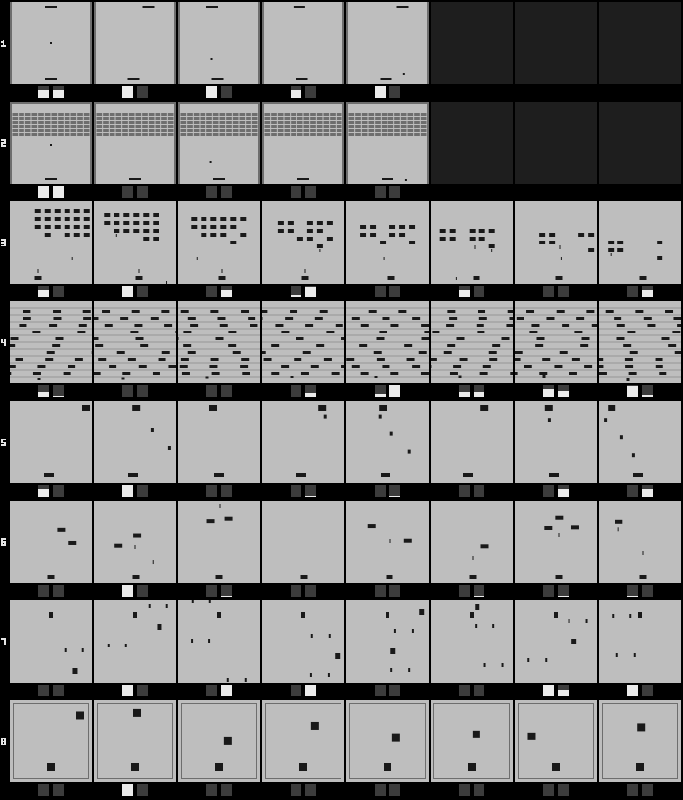

# M7f report — 직접 만든 고전 방식 게임 8종, 1부 (게임과 비교 봇) · 2부 (초파리)

구현 세션(서버 창), 2026-10-31. 사양: `docs/m7f-brief.md`(추가 등록 1·2 포함). 배경: `docs/m7-game-ladder.md`.
의존성은 numpy와 표준 라이브러리뿐이다(2부의 뇌는 기존 torch 엔진). 1~6절은 1부로 초파리가 없다. 초파리는 7절(2부)이다.

**2부 요약 (7절).**
- 초파리는 24개 비교 가운데 4개를 이겼다. 권투에서 무작위·고정 행동 기준·뇌 없는 봇 셋 모두를 이겼다(2.4 대 0.2 / 0.0 / 0.0). 외계 편대 막기에서는 고정 행동 기준만 이겼다.
- 길 건너기에서는 고정 행동 기준(항상 JUMP)에 졌다. 나머지는 구별되지 않는다.
- 권투에서 이긴 것이 상대에 반응한 결과인지, 천천히 위로 올라간 것만으로 생긴 결과인지는 이 결과로 가를 수 없다(7.3절).
- 점화(`like_for_like`)와 실패 경고는 1,760판 모두 0이다.

원본 수치: `data-provenance/m7f-baselines.json`(규칙 전부, θ 학습표, 시드별 점수, 감지기 조사, 조정 기록).
실행: `python -m flysim.apps.games.m7f part1`(16개 작업자, 269 s).

## 1. 결과표 (평가 시드 10~19, 평균과 범위)

| 게임 | 무작위 | 고정 행동 기준 | 뇌 없는 봇 (θ) | 반칙 봇 (천장 참고) |
|---|---|---|---|---|
| 공 받아치기 (`paddle`) | 0.7 (0~3) | NOOP 0.9 (0~3) | 0.9 (0~3) (θ = 3.162e-05) | 26.0 (26~26) |
| 벽돌 깨기 (`bricks`) | 0.8 (0~3) | NOOP 1.0 (0~4) | 1.0 (0~4) (θ = 0.001) | 42.9 (34~59) |
| 외계 편대 막기 (`formation`) | 14.1 (12~17) | NOOP 12.0 (12~12) | 17.3 (13~19) (θ = 0.0005012) | 121.8 (101~133) |
| 길 건너기 (`crossing`) | 0.0 (0~0) | JUMP 1.7 (0~4) | 0.0 (0~0) (θ = 0.001) | 15.6 (15~18) |
| 폭탄 받기 (`catch`) | 1.0 (0~3) | NOOP 0.7 (0~4) | 0.8 (0~4) (θ = 7.943e-05) | 139.0 (139~139) |
| 악마 물리치기 (`demons`) | 25.5 (16~46) | NOOP 43.1 (19~71) | 28.4 (11~49) (θ = 0.005012) | 57.8 (50~66) |
| 스키 활강 (`ski`) | 10.8 (5~16) | NOOP 14.6 (10~21) | 14.6 (10~21) (θ = 0.01) | 64.0 (63~66) |
| 권투 (`boxing`) | 0.2 (0~2) | NOOP 0.0 (0~0) | 0.0 (0~0) (θ = 0.001) | 118.9 (118~120) |

- **반칙 봇은 비교 대상이 아니다.** 게임 상태를 읽는 단순한 규칙(게임마다 `oracle()`)으로, 이 규칙에서 어디까지 가는지 보이는 천장 참고값이다.
- **고정 행동 기준**은 네 고정 행동 봇 가운데 평가 평균이 가장 높은 것이다(동률이면 NOOP, JUMP, LEFT, RIGHT 순). 넷 다 아래 표에 있다.
- **천장 표시:** 뇌 없는 봇이 반칙 봇과 10시드 전부 같은 게임은 **없다**(8종 모두 `brainless_equals_oracle` = false).
- 무작위·고정 행동·뇌 없는 봇 셋 다 0~1점대에 머무는 게임이 다섯이다: 공 받아치기, 벽돌 깨기, 길 건너기, 폭탄 받기, 권투. 셋 중 하나라도 반칙 봇 근처에 간 게임은 없다.
- 공 받아치기·벽돌 깨기·스키 활강에서는 뇌 없는 봇의 시드별 점수가 "항상 NOOP"과 **완전히 같다.** 이 세 게임에서 고른 θ의 뇌 없는 봇은 점수로는 아무것도 안 하는 봇과 구별되지 않는다. 폭탄 받기는 한 시드만 다르다(1 대 0).
- 외계 편대 막기에서만 뇌 없는 봇(17.3)이 무작위(14.1)와 고정 행동 기준(12.0)보다 높다. 악마 물리치기에서는 가만히 있는 봇(43.1)이 가장 높다. 가운데 서서 저절로 쏘면 위를 지나가는 적이 맞는다.

### 1.1 고정 행동 봇 넷

| 게임 | 항상 NOOP | 항상 JUMP | 항상 LEFT | 항상 RIGHT | 기준 |
|---|---|---|---|---|---|
| 공 받아치기 | 0.9 (0~3) | 0.9 (0~3) | 0.0 (0~0) | 0.0 (0~0) | NOOP |
| 벽돌 깨기 | 1.0 (0~4) | 1.0 (0~4) | 0.0 (0~0) | 0.0 (0~0) | NOOP |
| 외계 편대 막기 | 12.0 (12~12) | 12.0 (12~12) | 7.0 (7~7) | 7.0 (7~7) | NOOP |
| 길 건너기 | 0.0 (0~0) | 1.7 (0~4) | 0.0 (0~0) | 0.0 (0~0) | JUMP |
| 폭탄 받기 | 0.7 (0~4) | 0.7 (0~4) | 0.1 (0~1) | 0.4 (0~2) | NOOP |
| 악마 물리치기 | 43.1 (19~71) | 43.1 (19~71) | 0.2 (0~1) | 0.6 (0~1) | NOOP |
| 스키 활강 | 14.6 (10~21) | 14.6 (10~21) | 0.0 (0~0) | 0.0 (0~0) | NOOP |
| 권투 | 0.0 (0~0) | 0.0 (0~0) | 0.0 (0~0) | 0.0 (0~0) | NOOP |

점프가 아무 일도 안 하는 여섯 게임에서 "항상 JUMP"는 "항상 NOOP"과 같은 판이다(테스트로 확인). 그래서 두 열이 같다. 길 건너기의 "항상 위"(1.7)가 유일하게 한 가지 행동만으로 점수를 낸다.

### 1.2 뇌 없는 봇의 θ 선택 (학습 시드 0~9)

| 게임 | θ | 학습 평균 | 동률 θ 수 (범위) | 평가 시드별 점수 |
|---|---|---|---|---|
| 공 받아치기 | 3.162e-05 | 0.7 | 3 (2.51e-05~3.98e-05) | 0 3 0 0 0 0 3 1 1 1 |
| 벽돌 깨기 | 0.001 | 0.9 | 36 (1e-05~0.1) | 0 4 0 0 0 0 2 1 2 1 |
| 외계 편대 막기 | 0.0005012 | 18.6 | 1 (—) | 18 16 18 19 13 18 19 18 18 16 |
| 길 건너기 | 0.001 | 0.0 | 41 (1e-05~0.1) | 0 0 0 0 0 0 0 0 0 0 |
| 폭탄 받기 | 7.943e-05 | 0.8 | 19 (1e-05~0.000631) | 1 0 1 0 2 4 0 0 0 0 |
| 악마 물리치기 | 0.005012 | 31.0 | 1 (—) | 49 25 44 21 13 46 20 33 11 22 |
| 스키 활강 | 0.01 | 13.4 | 22 (0.000794~0.1) | 16 11 10 19 10 19 10 21 15 15 |
| 권투 | 0.001 | 0.0 | 41 (1e-05~0.1) | 0 0 0 0 0 0 0 0 0 0 |

절차는 M7b와 같다(`runner.select_threshold`, `THETA_GRID` 41점, 동률이면 동률 구간의 기하 중앙). 길 건너기와 권투는 41점 전부 학습 평균 0이라 격자 가운데(0.001)가 골라졌다. 규칙("양쪽 다 넘으면 점프, 한쪽만 넘으면 반대쪽")은 첫 칸과 같고 게임마다 바꾸지 않았다.

### 1.3 판 길이 (평가 시드, 중앙값과 범위)

| 게임 | 무작위 | 고정 기준 | 뇌 없는 봇 | 반칙 봇 |
|---|---|---|---|---|
| 공 받아치기 | 6.4 s (5.2~12.2) | 6.4 s (5.2~12.8) | 6.4 s (5.2~12.8) | 60.0 s |
| 벽돌 깨기 | 5.1 s (5.1~9.2) | 5.8 s (5.1~10.8) | 5.8 s (5.1~10.8) | 60.0 s |
| 외계 편대 막기 | 10.2 s (9.6~11.0) | 10.6 s (10.6~10.6) | 10.7 s (6.7~12.3) | 60.0 s |
| 길 건너기 | 60.0 s | 60.0 s | 60.0 s | 60.0 s |
| 폭탄 받기 | 8.9 s (8.7~10.2) | 8.7 s (8.7~10.7) | 8.7 s (8.7~10.7) | 60.0 s |
| 악마 물리치기 | 25.1 s (16.7~60.0) | 35.5 s (16.6~60.0) | 23.9 s (13.1~42.8) | 60.0 s |
| 스키 활강 | 60.0 s | 60.0 s | 60.0 s | 60.0 s |
| 권투 | 60.0 s | 60.0 s | 60.0 s | 60.0 s |

목숨이 있는 게임에서 반칙 봇이 아닌 봇의 판은 짧다.
- 공 받아치기·벽돌 깨기·폭탄 받기는 5~11 s 안에 세 번 놓친다. 공·폭탄이 처음 오는 데 1 s(서브·라운드 시작 대기 60틱)가 걸리고, 놓치는 데도 몇 초면 된다.
- **외계 편대 막기는 목숨이 아니라 편대가 포대 줄에 닿아서 끝난다.** 무작위 봇 평가 10판은 끝날 때 목숨이 1~3개 남아 있었고, 항상 NOOP은 약 10.6 s(634틱)에 편대가 내려와 끝났다. 편대를 다 없애지 못하면 약 10 s 안에 끝나는 게임이다. 조정 검사 때 판 길이를 보지 않아서 이 사실을 1부를 돌린 뒤에 알았다. 상수는 바꾸지 않았다.
- 2부의 초파리 판도 이 길이 안에서 끝날 가능성이 크다는 것을 미리 적어 둔다(예상이고 판정에 쓰지 않는다).

## 2. 게임 8종 (규칙 상수는 코드에 고정, `describe()`에 전부 실림)

`flysim/apps/games/classic/` — 게임마다 한 파일과 공통 도우미 `common.py`. `base.make` 등록표에는 이름 8개만 추가했다(`base.py`의 유일한 수정). 상표명은 이름·제목·`describe()`·소스 어디에도 없다(테스트). 장르를 설명하려고 여기서만 원작을 적는다.

| 이름 | 제목 | 장르 (원작) | 점프(=위) | 저절로 일어나는 것 | 점수 | 끝 |
|---|---|---|---|---|---|---|
| `paddle` | 공 받아치기 | 탁구형 (Pong) | 없음 | 서브, 득점 60틱 뒤 | 받아친 횟수 | 놓침 3번 |
| `bricks` | 벽돌 깨기 | 벽돌형 (Breakout) | 없음 | 서브, 공 잃고 60틱 뒤 | 깬 벽돌 수 | 공 3개 잃음 |
| `formation` | 외계 편대 막기 | 편대 사격형 (Space Invaders) | 없음 | 사격, 화면에 한 발, 앞 발 뒤 20틱 | 맞힌 적 수 | 목숨 3개 / 편대가 포대 줄 |
| `crossing` | 길 건너기 | 길 건너기형 (Freeway) | **위로 걷기** | 없음 | 건넌 횟수 | 60 s |
| `catch` | 폭탄 받기 | 받기형 (Kaboom) | 없음 | 라운드 시작, 60틱 뒤 | 받은 폭탄 수 | 놓침 3번 |
| `demons` | 악마 물리치기 | 공중 적 사격형 (Demon Attack) | 없음 | 사격, 화면에 한 발, 앞 발 뒤 20틱 | 맞힌 적 수 | 목숨 3개 |
| `ski` | 스키 활강 | 활강형 (Skiing) | 없음 | 없음 | 통과한 문 수 | 60 s |
| `boxing` | 권투 | 권투형 (Boxing) | **위로 이동** | 펀치, 양쪽 같은 30틱 주기 | 맞힌 펀치 수 | 60 s |

공통(지시서 §1): 84×84 uint8, 1틱 = 1/60 s, 판 길이 3,600틱(60 s) 또는 게임 오버, 원작에 목숨이 있으면 3개, 무작위는 `reset`의 `self.rng` 하나, 원근 없는 2D. 게임마다 정한 세부(크기·속도·주기·출현 규칙·컴퓨터 상대 규칙)는 각 파일 머리말과 `describe()["constants"]`에 있다. 눈여겨볼 몇 가지:

- **공 받아치기:** 컴퓨터 막대 최고 속도 0.5 px/틱. 막대 끝에 맞은 공은 옆으로 최대 1.2 px/틱으로 가므로 컴퓨터가 놓칠 수 있다. 컴퓨터가 놓치면 점수 없이 다시 서브한다.
- **벽돌 깨기:** 벽돌 6줄 × 12개, 한 틱에 한 개. 다 깨면 새 벽이 나온다.
- **외계 편대 막기:** 4줄 × 6개, 행진 속도 0.2 px/틱에서 시작해 맞힐 때마다 +0.02. 40틱마다 무작위 열에서 폭탄(동시에 최대 2개).
- **길 건너기:** 차선 10개(높이 7 px), 차 8×3 px, 보행자 3×3 px, 걷는 속도 0.5 px/틱. 차선별 차 수와 속도는 고정이고 위상만 무작위다. 치이면 한 차선 뒤로 밀리고 20틱 동안 멈춘다. 왼쪽·오른쪽은 아무 일도 안 한다(원작에 없음).
- **폭탄 받기:** 라운드마다 폭탄 수·낙하 속도·투하 간격·폭격수 속도가 오른다(최대 7단계). 하나 놓치면 떨어지던 폭탄이 다 터지고 같은 단계를 다시 한다.
- **악마 물리치기:** 적 셋이 각자 무작위 목표점으로 날고, 60~120틱마다 아래로 쏜다. 맞은 적은 60틱 뒤 다른 자리에 다시 나온다.
- **스키 활강:** 슬로프가 0.75 px/틱으로 올라온다. 40 px마다 문(안쪽 폭 16 px), 문 사이 가운데에 확률 0.5로 나무가 있다. 부딪히면 30틱 동안 멈춘다.
- **권투:** 위에서 본 링. 플레이어는 아래쪽에서 위를 보고, 아래로는 못 움직인다. 컴퓨터는 링 위쪽 절반의 무작위 목표점으로 0.5 px/틱으로 걷는다. 펀치는 양쪽 같은 틱에 저절로 나가고, 사거리(마주 보는 가장자리 사이 6 px 이하)와 정렬(중심 좌우 차 4 px 이하) 조건이 대칭이라 한쪽이 맞히면 다른 쪽도 맞힌다. 맞은 쪽은 6 px 밀린다.

### 2.1 그림체는 집 규칙이다
배경 190, 움직이지 않는 것(벽·차선 줄·벽돌·링 줄) 110, 움직이는 것(공·탄·적·차·폭탄·나무·깃발·플레이어 자신) 25. `base.SKY`/`GROUND`/`OBJECT` 값 그대로이고 가장자리는 `base.fill_rect`로 그린다. **이것은 첫 칸과 같은 집 규칙이고 게임별 선택이 아니다.** 아타리(검은 배경에 밝은 물체)와 달리 이 그림체에서는 우리 감지기(어두워지는 면적의 증가)가 새로 나타나거나 커지는 물체를 본다.

### 2.2 장면 기록
`scene()`은 그 틱의 화면을 그린 사각형을 그리는 순서대로 낸다. 형식은 `{"rects": [{"kind", "rect": [x0, x1, y0, y1], "value"}], "hud": {score, lives, tick}}`이고, 고정물을 먼저, 움직이는 것을 나중에 그린다. 화면 좌표이고 반올림하지 않는다. `_render()`는 배경 위에 이 목록을 차례로 그린 것이다. **JSON으로 왕복한 장면 기록으로 다시 그린 화면이 매 틱 프레임과 같다**(테스트: 8종 × 무작위·반칙 봇, 최대 1,500틱). 고정물 층은 바뀔 때만 다시 그린다(벽돌이 깨질 때 등). 순서가 같으므로 결과도 같다.

## 3. 같은 눈이 보는 것 (기록, 선택에 안 씀)

무작위 봇이 학습 시드 0~9에서 플레이한 모든 프레임(첫 프레임 포함)에 `LoomingDetector`를 돌렸다. "0 아닌 비율"은 반쪽-프레임 단위다.

| 게임 | 프레임 수 | 0 아닌 비율 (좌 / 우) | 평균 loom_L | 평균 loom_R | 0 아닌 값의 p99 | 최대 |
|---|---|---|---|---|---|---|
| 공 받아치기 | 4,202 | 0.268 (0.254 / 0.282) | 5.78e-05 | 5.93e-05 | 0.0007336 | 0.0009181 |
| 벽돌 깨기 | 3,732 | 0.194 (0.203 / 0.185) | 4.98e-05 | 5.07e-05 | 0.0005514 | 0.0009182 |
| 외계 편대 막기 | 5,794 | 0.267 (0.275 / 0.260) | 0.000161 | 0.000144 | 0.001463 | 0.002507 |
| 길 건너기 | 36,000 | 0.498 (0.495 / 0.502) | 0.00041 | 0.000387 | 0.002634 | 0.004312 |
| 폭탄 받기 | 5,820 | 0.177 (0.184 / 0.170) | 0.000125 | 0.000128 | 0.002201 | 0.003669 |
| 악마 물리치기 | 15,433 | 0.352 (0.350 / 0.354) | 0.000134 | 0.000139 | 0.005868 | 0.006603 |
| 스키 활강 | 36,000 | 0.343 (0.346 / 0.340) | 6.11e-05 | 6.31e-05 | 0.001105 | 0.0018 |
| 권투 | 36,000 | 0.220 (0.206 / 0.233) | 0.000102 | 0.000102 | 0.002196 | 0.002212 |

- 8종 모두 감지기가 0이 아닌 값을 낸다. "감지기가 보지 못함"으로 적을 게임은 이 조사에서는 없다. 2부의 `p99`는 이 표가 아니라 뇌 없는 봇이 본 프레임으로 따로 잰다(지시서 §4).
- 이 감지기는 "다가옴"이 아니라 반쪽마다 **어두운 면적이 늘어난 양**을 잰다. 정의상 값이 나는 경우는 그 반쪽에 어두운 것이 새로 나타나거나 들어올 때다(화면 반쪽 경계를 넘거나, 화면 가장자리로 들어오거나, 새로 생기거나). 한 반쪽 안에서 옆으로 움직이는 물체 하나는 0이다(차 크기 사각형이 0.6 px/틱으로 39틱 움직이는 동안 0 아닌 값 0번, 확인함). 첫 칸처럼 물체가 커지면서 다가오는 장면은 이 8종에 없다.
- 길 건너기(0.498)가 가장 높다. 차 25대가 늘 화면 가운데 경계와 양 끝을 드나들기 때문으로 보인다(추정, 따로 확인하지 않음).

`docs/m7f-survey.png`: 한 줄이 한 게임이다. 1~8번은 위 표 순서(공 받아치기, 벽돌 깨기, 외계 편대 막기, 길 건너기, 폭탄 받기, 악마 물리치기, 스키 활강, 권투)다. 뇌 없는 봇(고른 θ), 평가 시드 10의 1 s, 2 s, …, 8 s 프레임(2배 확대)이고, 그 아래에 그 프레임의 `loom_L`·`loom_R` 막대가 있다. **막대는 줄마다 그 줄의 최대값으로 맞췄다**(줄별 기준값은 결과 파일 `figure.row_full_scale`; 0보다 크면 최소 1픽셀). 그래서 줄끼리 막대 높이를 비교하면 안 된다. 판이 끝난 뒤의 칸은 어둡게 비워 두었다(공 받아치기 5.2 s, 벽돌 깨기 5.1 s에 끝남).

## 4. 조정 이력 (봇을 돌리기 전, 아무것도 안 하는 봇과 반칙 봇으로만)

원본: `runs/m7f/tuning-log.jsonl`(결과 파일 `tuning_log`에 그대로 복사). 1부 실행 코드는 각 게임의 상수가 마지막 조정 검사 때와 같을 때만 돈다(규칙 해시 비교). 결과 파일이 생긴 뒤에는 `tune`이 거부한다.

1. **처음 상수, 검사 1회 (20:29, 학습 시드 0~9).** 평균과 범위.

   | 게임 | 아무것도 안 함 | 반칙 봇 | 판단 |
   |---|---|---|---|
   | 공 받아치기 | 0.5 (0~1) | 26.0 (10시드 모두 26) | 통과 |
   | 벽돌 깨기 | 0.9 (0~3) | 40.7 (24~55) | 통과 |
   | 외계 편대 막기 (당시 이름 `invaders`) | 11.9 (11~12) | 118.8 (91~128) | 통과 |
   | 길 건너기 | 0.0 | **0.0** | **실패** |
   | 폭탄 받기 | 0.4 (0~3) | 139 (10시드 모두 139) | 통과 |
   | 악마 물리치기 | 23.9 (9~47) | 58.6 (51~66) | 통과 (평균은 분명히 낮음, 시드별 최고 47과 최저 51이 가깝다) |
   | 스키 활강 | 13.4 (8~22) | 63.5 (60~65) | 통과 |
   | 권투 | 0.0 | 118.9 (118~120) | 통과 |

   - "의미 있는 점수 폭"은 0부터 반칙 봇 점수까지의 범위로 읽었다(총괄 수용).
   - 공 받아치기와 폭탄 받기는 반칙 봇이 시드마다 같은 점수를 낸다. 공 받아치기는 반칙 봇이 막대 가운데로 받아 공이 거의 곧게 가고, 컴퓨터가 한 번도 놓치지 않아 랠리 길이가 같다. 폭탄 받기는 투하 일정이 시드와 무관하고 반칙 봇이 60 s 안의 폭탄을 다 받는다. 천장 규칙이 처리한다(총괄 판단).
   - 7종은 상수를 하나도 바꾸지 않았다.
2. **길 건너기 반칙 봇 규칙 (처음 상수, 검사 전후).** 반칙 봇 규칙은 세 번 바뀌었고, 셋 다 처음 상수에서 0점이었다. "앞으로 16틱 동안 걸어도 안 부딪히면 걷기"(시드 0), "45틱 탐색"(시드 0~2), "160틱 계획: 걷기/기다리기 모든 계획 중 가장 일찍 건너는 것"(시드 0~3과 검사 1). 마지막 규칙을 최종으로 쓴다.
3. **절차 예외 — 고지.**
   - 원인을 찾다가 구현 창이 길 건너기에서 고정 행동 봇 **"항상 위"를 학습 시드 0~3에서 돌렸다.** 0점이었고 충돌은 112~113번이었다.
   - 화면 재그리기 검사로 **시험용 무작위 행동**(`RandomAgent`가 아닌 시험 난수, 시드 0)을 8종에서 한 판씩 돌렸다. 판 길이(틱)만 출력했고 점수는 보지 않았다.
   - 둘 다 총괄에 보고했다. 총괄은 이 실행이 반칙 봇 검사가 이미 보인 것("아무도 못 건넌다")보다 더 알려 준 것이 없다고 판단했고, 길 건너기 재조정을 예외로 허락했다(지시서 추가 등록 1).
4. **길 건너기 재조정 (추가 등록 1, 20:32).**
   - 원인: 이웃 차선의 차 사이 빈칸(6 − 4 = 2 px)이 보행자 키(4 px)보다 작았다. 그래서 도로 위에 안전한 자리가 없었다.
   - 근거는 점수가 아니라 기하 조건 "차 사이 빈칸 > 보행자 키"다.
   - 바꾼 값: 차선 높이 6→7, 도로 위 끝 12→7, 차 높이 4→3, 보행자 4×4→3×3, 출발 위치 76→79. 빈칸 4 px > 보행자 3 px(테스트).
   - 속도·차 수·걷는 속도·밀림 규칙은 그대로다.
   - 재확인: 아무것도 안 함 0.0, 반칙 봇 15.2 (15~16). 통과.
5. **이름 변경 (추가 등록 2).** `invaders` → `formation`. 상수는 그대로이고 검사 결과도 처음과 같다(11.9 / 118.8, 시드별로 같음). 한국어 제목 "외계 편대 막기"는 그대로다. 상표명 검사는 원작 제목 전체 문자열(`pong`, `breakout`, `space invaders`, `freeway`, `kaboom`, `demon attack`, `skiing` 등)과 `invaders`로 한다. 원작 제목 "Boxing"은 지시서가 이 게임의 이름으로 쓰는 일반 단어와 같아 검사 목록에 넣을 수 없다.
6. 그 뒤 1부를 한 번 돌렸다(20:32:47 시작). 그 뒤로 상수를 바꾸지 않았다.

## 5. 산출물과 확인
- `flysim/apps/games/classic/`(8종 + `common.py`), `flysim/apps/games/m7f.py`(`tune`, `part1`. 2부는 2부 지시 때 추가), `base.make` 등록표 8줄.
- `tests/test_classic_games.py`: 게임마다 결정론(같은 시드·같은 행동 → 같은 프레임·점수, 다른 시드 → 다른 판), 84×84 uint8, 장면 기록 재그리기 = 프레임(매 틱, JSON 왕복), 종류 이름과 회색값이 지시서 표와 집 규칙대로, 3,600틱 상한과 목숨, 상표명 없음(이름·제목·`describe()`·소스), 행동 뜻(점프가 아무 일도 안 하는 게임은 항상 JUMP = 항상 NOOP, 길 건너기의 왼쪽·오른쪽 = NOOP, 위로 걷기·이동, 좌우 이동 방향), 저절로 일어나는 서브·사격·라운드 시작·펀치 주기, 길 건너기 기하 조건, 결과 파일의 규칙이 지금 코드와 같음, 평가 시드 10의 무작위·고정 기준 점수 재현(공 받아치기, 길 건너기).
- `pytest tests/` 전부 통과: 636개 통과, 4개 건너뜀. 건너뛴 넷은 이 창 것이 아니다: 다른 CUDA 프로세스가 GPU를 같이 써서 건너뛴 실시간 서버 성능 측정 1개, M7g 결과가 아직 없어 건너뛴 1개, 실제 묶음 전용 보여 주기 화면 테스트 2개.
- `data-provenance/m7f-baselines.json`, `docs/m7f-survey.png`, 이 보고서.

## 6. 2부로 넘기는 것 (기록만, 판정 아님)
- 2부 설정은 지시서 §4 그대로다. `p99`는 각 게임의 뇌 없는 봇(위 θ)이 학습 시드 0~9에서 본 프레임으로 잰다.
- 다섯 게임(공 받아치기, 벽돌 깨기, 길 건너기, 폭탄 받기, 권투)은 무작위·고정 행동·뇌 없는 봇이 모두 0~1.7점대다. 초파리가 "이겼다"(짝 차이 > 3 표준오차)를 받으려면 이 바닥 위로 꾸준히 올라와야 한다.
- 목숨이 있는 게임은 반칙 봇이 아닌 봇의 판이 5~12 s(악마 물리치기는 13~60 s)로 짧다. 외계 편대 막기는 편대가 내려와서 끝난다. 초파리 판도 짧을 수 있다.

## 7. 2부 — 초파리 (지시서 §4, M7c2 주 팔과 같은 설정)

- 설정: 동작점 P2, 예열 5,000 스텝, `CountWindowDecoder(300 ms, 2)`(M7c2 해독기 선택 파일과 대조해 확인). 입력은 왼쪽 `LC4`·`LPLC2` 전부에 `k·loom_L`, 오른쪽에 `k·loom_R`이다. 시냅스 연결은 고치지 않았다. 게임마다 바뀐 것은 `k` 하나다.
- 감지기(반쪽 화면이 어두워지는 증가분만 보는 looming)와, 그 값을 `LC4`·`LPLC2`에 전류로 넣는 연결은 **가정**이다(M7 사다리와 같다).
- 원본 수치: `data-provenance/m7f-results.json`. 게임마다 p99, k 21줄, 평가 10판의 판별 기록, 판정이 있고, 대조군, 비교 봇 재현값, 묶음 위치가 함께 들어 있다.
- 실행: `python -m flysim.apps.games.m7f part2 --games <게임들> --workers 8`.
  - 세 프로세스를 GPU 하나에서 동시에 돌렸다. 묶음은 길 건너기·공 받아치기·벽돌 깨기, 스키 활강·폭탄 받기·외계 편대 막기, 권투·악마 물리치기다.
  - 각 4,156~4,265 s(약 71분)가 걸렸다(예상 1.5~2시간). 시작 직후 잠깐 총괄의 검증 실행이 GPU를 같이 썼다.
  - 세 결과는 `python -m flysim.apps.games.m7f merge runs/m7f/part2-*.json`으로 합쳤다. 합칠 때 공통 키가 세 파일에서 같은지 확인했고 같았다. 공통 키는 커밋, 시드, 예열, 뇌, 감지기, 해독기, 해독기 선택, 규칙, 대조군이다.
- 각 프로세스는 초파리를 돌리기 전에 두 가지를 다시 확인했다. 다르면 멈추게 되어 있다.
  1. 게임 규칙이 1부 결과 파일과 같은지.
  2. 무작위·고정 행동 기준·뇌 없는 봇·반칙 봇의 평가 시드 점수가 1부와 같은지(다시 돌려 확인).

  둘 다 같았다.
- 실행 때 코드는 이 커밋의 `m7f.py`와 같다(마지막 수정 20:49, 실행 시작 21:48). 결과 파일의 `git_commit`(33167bf)은 실행 때의 HEAD다.

### 7.1 점수와 판정 (평가 시드 10~19, 평균과 범위)

| 게임 | 초파리 (k) | 무작위 | 고정 행동 기준 | 뇌 없는 봇 | 반칙 봇 | 대 무작위 | 대 고정 행동 | 대 뇌 없는 봇 |
|---|---|---|---|---|---|---|---|---|
| 공 받아치기 | **0.5** (0~2, k = 3.286e+05) | 0.7 | NOOP 0.9 | 0.9 | 26.0 | 구별 안 됨 | 구별 안 됨 | 구별 안 됨 |
| 벽돌 깨기 | **0.8** (0~3, k = 7.023e+05) | 0.8 | NOOP 1.0 | 1.0 | 42.9 | 구별 안 됨 | 구별 안 됨 | 구별 안 됨 |
| 외계 편대 막기 | **17.0** (12~22, k = 1.099e+06) | 14.1 | NOOP 12.0 | 17.3 | 121.8 | 구별 안 됨 | 이김 | 구별 안 됨 |
| 길 건너기 | **0.0** (0~0, k = 2.716e+04) | 0.0 | JUMP 1.7 | 0.0 | 15.6 | 구별 안 됨 | 짐 | 구별 안 됨 |
| 폭탄 받기 | **1.1** (0~4, k = 1.951e+04) | 1.0 | NOOP 0.7 | 0.8 | 139.0 | 구별 안 됨 | 구별 안 됨 | 구별 안 됨 |
| 악마 물리치기 | **36.3** (17~60, k = 940.3) | 25.5 | NOOP 43.1 | 28.4 | 57.8 | 구별 안 됨 | 구별 안 됨 | 구별 안 됨 |
| 스키 활강 | **13.8** (9~21, k = 3398) | 10.8 | NOOP 14.6 | 14.6 | 64.0 | 구별 안 됨 | 구별 안 됨 | 구별 안 됨 |
| 권투 | **2.4** (0~7, k = 2.277e+05) | 0.2 | NOOP 0.0 | 0.0 | 118.9 | 이김 | 이김 | 이김 |

- 판정은 M7c 규칙을 따른다. 시드별 짝 차이(초파리 − 상대)의 평균이 표준오차의 3배를 넘어야 이기거나 진다. 아래 표가 그 값이다.

| 게임 | 짝 차이 평균 ± SEM: 대 무작위 | 대 고정 행동 | 대 뇌 없는 봇 |
|---|---|---|---|
| 공 받아치기 | -0.20 ± 0.36 | -0.40 ± 0.22 | -0.40 ± 0.22 |
| 벽돌 깨기 | +0.00 ± 0.33 | -0.20 ± 0.33 | -0.20 ± 0.33 |
| 외계 편대 막기 | +2.90 ± 1.37 | +5.00 ± 1.03 | -0.30 ± 0.92 |
| 길 건너기 | +0.00 ± 0.00 | -1.70 ± 0.47 | +0.00 ± 0.00 |
| 폭탄 받기 | +0.10 ± 0.41 | +0.40 ± 0.27 | +0.30 ± 0.30 |
| 악마 물리치기 | +10.80 ± 5.20 | -6.80 ± 4.20 | +7.90 ± 5.38 |
| 스키 활강 | +3.00 ± 1.63 | -0.80 ± 0.47 | -0.80 ± 0.47 |
| 권투 | +2.20 ± 0.70 | +2.40 ± 0.69 | +2.40 ± 0.69 |

- **감지기가 보지 못한 게임은 없다.** 8종 모두 뇌 없는 봇의 프레임에 0이 아닌 `loom`이 있었다. 가장 적은 벽돌 깨기도 296개다.
- **천장 게임도 없다**(1부와 같다).
- **이김은 24개 비교 가운데 4개다.**
  - 권투에서 세 상대 모두를 이겼다. 초파리 2.4, 무작위 0.2, 고정 행동 기준과 뇌 없는 봇 각 0.0이다(7.3절).
  - 외계 편대 막기에서는 고정 행동 기준(NOOP 12.0)만 이겼다. 초파리 17.0은 무작위 14.1, 뇌 없는 봇 17.3과 구별되지 않는다. 가만히 있는 것보다는 높지만, 같은 입력에 임계값 한 줄을 건 봇과 같다.
- **짐은 1개다.** 길 건너기에서 고정 행동 기준(항상 JUMP, 1.7)에 졌다. 초파리는 10판 모두 0점이다.
- 나머지 여섯 게임은 세 상대 모두와 구별되지 않는다.
  - 악마 물리치기는 평균 차이가 크다. 무작위보다 +10.8, 뇌 없는 봇보다 +7.9, 가만히 있는 봇보다 −6.8이다. 하지만 시드별 점수가 크게 흩어져 3 표준오차에 못 미친다.
- 비교는 모두 24개다. 3 표준오차 규칙은 사전 등록 그대로 적용했다. 여러 번 비교한 것에 대한 보정은 규칙에 없다(기록).

### 7.2 게임별 p99와 고른 k

| 게임 | p99 (0 아닌 값 수) | 고른 k | 동률 수 | 평가 시드별 점수 | 판 길이 중앙값 | 행동 (NOOP/JUMP/LEFT/RIGHT, 평가 10판 합) |
|---|---|---|---|---|---|---|
| 공 받아치기 | 0.000784 (3,612) | 3.286e+05 | 3 | 0 2 0 0 0 0 1 0 1 1 | 5.2 s | 3607/205/30/46 |
| 벽돌 깨기 | 0.0003668 (296) | 7.023e+05 | 1 | 0 1 0 0 0 0 2 1 3 1 | 5.8 s | 3570/108/19/27 |
| 외계 편대 막기 | 0.001294 (4,998) | 1.099e+06 | 1 | 18 12 17 22 14 17 14 22 16 18 | 10.2 s | 4280/348/770/952 |
| 길 건너기 | 0.002634 (35,810) | 2.716e+04 | 21 | 0 0 0 0 0 0 0 0 0 0 | 60.0 s | 31356/192/1878/2574 |
| 폭탄 받기 | 0.003667 (4,688) | 1.951e+04 | 1 | 0 0 2 2 1 4 1 0 1 0 | 9.2 s | 5233/25/126/166 |
| 악마 물리치기 | 0.005869 (10,017) | 940.3 | 1 | 60 41 17 33 42 53 26 30 43 18 | 30.1 s | 19220/14/8/21 |
| 스키 활강 | 0.0006914 (25,005) | 3398 | 1 | 13 9 9 16 9 20 11 21 15 15 | 60.0 s | 35960/3/9/28 |
| 권투 | 0.0007381 (14,112) | 2.277e+05 | 1 | 2 1 4 7 4 3 1 0 2 0 | 60.0 s | 34587/349/437/627 |

- **동률은 규칙대로 기하 중앙을 골랐다.**
  - 길 건너기는 21줄이 모두 0점이라 11번째 점(k = 2.716e+04)이다.
  - 공 받아치기는 0.90인 줄이 셋(3.885e+04, 3.286e+05, 5.037e+05)이라 가운데 것이다.
- **악마 물리치기와 스키 활강에서 고른 k는 초파리가 거의 움직이지 않는 줄이다.**
  - 평가 10판에서 NOOP이 아닌 행동은 악마 물리치기 43개(0.2 %), 스키 활강 40개(0.1 %)다.
  - 첫 행동은 판마다 악마 물리치기 5~37 s, 스키 활강 4~45 s 뒤에 나왔다. 악마 물리치기 시드 10은 끝까지 한 번도 움직이지 않았다. 그 판의 점수 60은 항상 NOOP 봇의 시드 10 점수와 같다.
  - 그래서 이 두 게임의 초파리 판은 사실상 "가만히 있기"에 움직임 몇 번이 섞인 판이다. 한 번만 움직여도 그 뒤 판이 달라져 점수가 갈린다(악마 물리치기 36.3 대 NOOP 43.1, 스키 활강 13.8 대 14.6).
- **k가 커지면 움직임이 늘고, 점수는 대개 떨어진다.**
  - 스키 활강은 14.9에서 5.4로 떨어진다. 폭탄 받기는 가장 큰 k에서 0.0이고, 권투는 2.9에서 0.5로 떨어진다.
  - 외계 편대 막기만 다르다. 학습 평균이 가장 높은 두 줄(22.1, 18.9)은 움직임이 33 %·24 %인 중간 이상 k다.
- **길 건너기에서는 앞으로 가지 못한다.**
  - 앞으로 가는 행동은 JUMP 하나다. 해독기는 300 ms 안에 양쪽 GF가 모두 2번 이상 발화해야 JUMP를 낸다.
  - 평가 10판 36,000틱 가운데 JUMP는 192번, 한 판에 평균 19번이다. 한 번 건너려면 약 150틱(75 px ÷ 0.5 px)이 필요하다.
  - 나머지 움직임은 길 건너기에서 아무 일도 하지 않는 LEFT·RIGHT다. 뇌 없는 봇도 0점이다.

### 7.3 권투에서 이긴 판 (기록, 판정 아님)

- **점수 조건.** 펀치는 30틱마다 저절로 나간다. 플레이어 위쪽 끝이 상대 아래쪽 끝보다 0~6 px 아래에 있고, 두 중심의 좌우 차이가 4 px 이하이면 맞는다.
- **위로 가지 않으면 맞힐 수 없다.**
  - 플레이어는 y = 68에서 시작하고 상대는 y 8~44 안에서만 움직인다. 위로 가지 않으면 간격이 16 px 이상이라 펀치가 닿지 않는다.
  - 1부에서 네 고정 행동 봇(NOOP·JUMP·LEFT·RIGHT)과 뇌 없는 봇은 10시드 모두 0점이었다. 무작위는 한 시드만 2점이었다.
- **초파리는 10시드 가운데 8시드에서 점수를 냈다(0~7점).** 평가 10판에서 JUMP(위로)는 판마다 13~72틱이고, NOOP이 아닌 행동은 판마다 2.5~5.2 %다.
- **평가 시드 10 묶음에서 플레이어는 천천히 올라갔다.**
  - 높이는 0 s y 68, 10 s 64, 20 s 54, 45 s 48, 50 s 40이었다.
  - 52 s와 53 s에 상대가 바로 위(y 30.6, 36.6)로 왔을 때 두 번 맞혔다. 펀치가 맞으면 서로 맞으므로 플레이어도 6 px 아래로 밀린다.
- **한 줄만 튀어나온 결과는 아니다.** k 격자에서 학습 평균이 0.9~2.9인 줄이 k 1.757e+04~5.35e+05 사이에 9줄 이어진다. 그 밖의 줄은 0~0.7이다.
- **재지 않은 것이 있다.** 화면을 보지 않고 낮은 비율로 위로 가기만 하는 봇이 같은 점수를 내는지는 돌리지 않았다. 이 사전 등록에 없는 비교이기 때문이다. 그래서 초파리의 움직임이 상대에 반응한 것인지, 천천히 올라간 것만으로 생긴 것인지는 이 결과로 가를 수 없다.

### 7.4 점화와 실패 경고 (판은 빼지 않고 표시만)

대조군은 시드 20개(0~19)이고, 예열 5 s 뒤 무입력 5 s를 돌렸다. 값은 M7c2 대조군과 같다.
- 망 발화율 0.268~0.281 Hz.
- 5 s 동안 한 번이라도 발화한 뉴런 65.6~66.2 %.
- 거대 신경섬유(GF) 자발 스파이크 한쪽당 8~11개(약 1.6~2.2 Hz).

| | `like_for_like` (표에 인용) | `literal` (기록용) | 폭주 | 뷰어 실패 |
|---|---|---|---|---|
| 평가 80판 | 0 | 80 | 0 | 0 |
| 학습 격자 1,680판 | 0 | 1,680 | 0 | 0 |

- `like_for_like` 초과분은 평가 80판에서 −0.17 ~ +0.29 %p다(기준 1 %p).
- 창 최대 망 발화율은 0.60 Hz다(기준 5 Hz). 창 최대 활성은 11.9 %다(기준 90 %).
- `literal`이 모든 판에 걸리는 이유는 M7c2 보고서 4절과 같다. 판의 창 최댓값을 대조군의 창 평균과 비교하기 때문이다.
- 게임 중 GF 스파이크는 양쪽 합 초당 3.5~7.7개다. 대조군은 3.2~4.4개다.
- **판 전체 발화 뉴런 비율(기록).**
  - 60 s 판(길 건너기·스키 활강·권투)은 100 %, 악마 물리치기는 94.4~100 %, 외계 편대 막기는 67.5~96.6 %다.
  - 대조군은 5 s 만에 이미 66 %이고, 판이 길수록 배경 잡음 발화가 쌓인다.
  - 뷰어 경고는 프레임마다 판정하고(`flysim-viewer.html` 720~724행), 사전 등록 실패 검사도 창마다 한다(M7c 추가 등록). 창 기준으로는 실패 경고 판이 없다.

### 7.5 재생 묶음 (평가 시드 10)

- 위치는 `runs/m7f/<게임>-brain-seed10/`이고, M7c2와 같은 형식에 `scene.json`을 더했다.
  - `run.json`: 뷰어용.
  - `frames.npz`: 프레임.
  - `game.json`: 규칙과 사건.
  - `scene.json`: 틱마다의 장면 기록.
- 쓰기 전에 장면 기록으로 다시 그린 그림이 프레임과 같은지 확인했다. `runs/`는 git에 넣지 않는다.

| 게임 | 점수 | 프레임 | 길이 | 묶음 스파이크 |
|---|---|---|---|---|
| 공 받아치기 | 0 | 312 | 5.2 s | 241,094 |
| 벽돌 깨기 | 0 | 306 | 5.1 s | 231,080 |
| 외계 편대 막기 | 18 | 671 | 11.2 s | 519,632 |
| 길 건너기 | 0 | 3,600 | 60.0 s | 2,764,603 |
| 폭탄 받기 | 0 | 522 | 8.7 s | 397,392 |
| 악마 물리치기 | 60 | 3,101 | 51.7 s | 2,350,337 |
| 스키 활강 | 13 | 3,600 | 60.0 s | 2,726,305 |
| 권투 | 2 | 3,600 | 60.0 s | 2,734,889 |

### 7.6 k 학습 21줄 (학습 시드 0~9, 고른 줄에 ←)

"행동 비율"은 학습 10판에서 NOOP이 아닌 틱의 비율이다.
#### 공 받아치기 (`paddle`) — k 21줄 (학습 시드 0~9)

| k | 학습 평균 | 범위 | 점화 | 실패 경고 | 행동 비율 (NOOP 아님) |
|---|---|---|---|---|---|
| 1275 | 0.60 | 0~1 | 0 | 0 | 0.0045 |
| 1955 | 0.70 | 0~2 | 0 | 0 | 0.0036 |
| 2996 | 0.60 | 0~1 | 0 | 0 | 0.0010 |
| 4593 | 0.60 | 0~1 | 0 | 0 | 0.0010 |
| 7039 | 0.60 | 0~1 | 0 | 0 | 0.0013 |
| 1.079e+04 | 0.60 | 0~1 | 0 | 0 | 0.0013 |
| 1.654e+04 | 0.60 | 0~1 | 0 | 0 | 0.0038 |
| 2.535e+04 | 0.60 | 0~2 | 0 | 0 | 0.0038 |
| 3.885e+04 | 0.90 | 0~4 | 0 | 0 | 0.0213 |
| 5.954e+04 | 0.60 | 0~3 | 0 | 0 | 0.0348 |
| 9.127e+04 | 0.80 | 0~4 | 0 | 0 | 0.0423 |
| 1.399e+05 | 0.80 | 0~5 | 0 | 0 | 0.0557 |
| 2.144e+05 | 0.60 | 0~2 | 0 | 0 | 0.0603 |
| 3.286e+05 ← | 0.90 | 0~3 | 0 | 0 | 0.0551 |
| 5.037e+05 | 0.90 | 0~6 | 0 | 0 | 0.0549 |
| 7.72e+05 | 0.60 | 0~3 | 0 | 0 | 0.0697 |
| 1.183e+06 | 0.70 | 0~5 | 0 | 0 | 0.0576 |
| 1.814e+06 | 0.70 | 0~4 | 0 | 0 | 0.1011 |
| 2.78e+06 | 0.40 | 0~1 | 0 | 0 | 0.2698 |
| 4.261e+06 | 0.70 | 0~2 | 0 | 0 | 0.3905 |
| 6.53e+06 | 0.50 | 0~2 | 0 | 0 | 0.3866 |

#### 벽돌 깨기 (`bricks`) — k 21줄 (학습 시드 0~9)

| k | 학습 평균 | 범위 | 점화 | 실패 경고 | 행동 비율 (NOOP 아님) |
|---|---|---|---|---|---|
| 2726 | 0.90 | 0~3 | 0 | 0 | 0.0008 |
| 4178 | 0.90 | 0~3 | 0 | 0 | 0.0008 |
| 6404 | 0.90 | 0~3 | 0 | 0 | 0.0039 |
| 9816 | 0.90 | 0~3 | 0 | 0 | 0.0034 |
| 1.504e+04 | 0.70 | 0~2 | 0 | 0 | 0.0033 |
| 2.306e+04 | 0.90 | 0~3 | 0 | 0 | 0.0026 |
| 3.534e+04 | 0.80 | 0~3 | 0 | 0 | 0.0097 |
| 5.417e+04 | 0.90 | 0~3 | 0 | 0 | 0.0286 |
| 8.303e+04 | 0.80 | 0~3 | 0 | 0 | 0.0282 |
| 1.273e+05 | 0.90 | 0~3 | 0 | 0 | 0.0326 |
| 1.951e+05 | 0.70 | 0~3 | 0 | 0 | 0.0390 |
| 2.99e+05 | 0.80 | 0~3 | 0 | 0 | 0.0580 |
| 4.582e+05 | 0.80 | 0~3 | 0 | 0 | 0.0510 |
| 7.023e+05 ← | 1.20 | 0~3 | 0 | 0 | 0.0498 |
| 1.077e+06 | 0.90 | 0~3 | 0 | 0 | 0.0620 |
| 1.65e+06 | 1.00 | 0~3 | 0 | 0 | 0.0540 |
| 2.529e+06 | 0.80 | 0~3 | 0 | 0 | 0.1372 |
| 3.876e+06 | 0.60 | 0~2 | 0 | 0 | 0.1352 |
| 5.941e+06 | 0.80 | 0~2 | 0 | 0 | 0.1716 |
| 9.106e+06 | 0.80 | 0~2 | 0 | 0 | 0.1453 |
| 1.396e+07 | 0.80 | 0~2 | 0 | 0 | 0.1826 |

#### 외계 편대 막기 (`formation`) — k 21줄 (학습 시드 0~9)

| k | 학습 평균 | 범위 | 점화 | 실패 경고 | 행동 비율 (NOOP 아님) |
|---|---|---|---|---|---|
| 772.9 | 12.30 | 12~14 | 0 | 0 | 0.0040 |
| 1185 | 11.80 | 9~13 | 0 | 0 | 0.0038 |
| 1816 | 11.70 | 11~12 | 0 | 0 | 0.0018 |
| 2783 | 11.90 | 11~12 | 0 | 0 | 0.0008 |
| 4266 | 11.90 | 11~12 | 0 | 0 | 0.0036 |
| 6538 | 12.10 | 12~13 | 0 | 0 | 0.0022 |
| 1.002e+04 | 12.00 | 11~14 | 0 | 0 | 0.0052 |
| 1.536e+04 | 12.30 | 11~14 | 0 | 0 | 0.0067 |
| 2.354e+04 | 13.30 | 10~19 | 0 | 0 | 0.0265 |
| 3.608e+04 | 13.10 | 12~14 | 0 | 0 | 0.0536 |
| 5.53e+04 | 15.10 | 13~20 | 0 | 0 | 0.0990 |
| 8.477e+04 | 14.70 | 10~19 | 0 | 0 | 0.1083 |
| 1.299e+05 | 15.20 | 12~17 | 0 | 0 | 0.1368 |
| 1.991e+05 | 15.60 | 9~22 | 0 | 0 | 0.1110 |
| 3.052e+05 | 18.20 | 9~38 | 0 | 0 | 0.1328 |
| 4.678e+05 | 15.70 | 11~30 | 0 | 0 | 0.1579 |
| 7.17e+05 | 18.90 | 15~23 | 0 | 0 | 0.2389 |
| 1.099e+06 ← | 22.10 | 13~49 | 0 | 0 | 0.3251 |
| 1.684e+06 | 17.10 | 14~19 | 0 | 0 | 0.5489 |
| 2.582e+06 | 15.10 | 12~18 | 0 | 0 | 0.7284 |
| 3.957e+06 | 18.00 | 14~27 | 0 | 0 | 0.7071 |

#### 길 건너기 (`crossing`) — k 21줄 (학습 시드 0~9)

| k | 학습 평균 | 범위 | 점화 | 실패 경고 | 행동 비율 (NOOP 아님) |
|---|---|---|---|---|---|
| 379.6 | 0.00 | 0~0 | 0 | 0 | 0.0017 |
| 581.8 | 0.00 | 0~0 | 0 | 0 | 0.0024 |
| 891.8 | 0.00 | 0~0 | 0 | 0 | 0.0021 |
| 1367 | 0.00 | 0~0 | 0 | 0 | 0.0026 |
| 2095 | 0.00 | 0~0 | 0 | 0 | 0.0026 |
| 3211 | 0.00 | 0~0 | 0 | 0 | 0.0074 |
| 4922 | 0.00 | 0~0 | 0 | 0 | 0.0175 |
| 7543 | 0.00 | 0~0 | 0 | 0 | 0.0331 |
| 1.156e+04 | 0.00 | 0~0 | 0 | 0 | 0.0682 |
| 1.772e+04 | 0.00 | 0~0 | 0 | 0 | 0.1099 |
| 2.716e+04 ← | 0.00 | 0~0 | 0 | 0 | 0.1283 |
| 4.163e+04 | 0.00 | 0~0 | 0 | 0 | 0.1542 |
| 6.381e+04 | 0.00 | 0~0 | 0 | 0 | 0.1793 |
| 9.78e+04 | 0.00 | 0~0 | 0 | 0 | 0.1947 |
| 1.499e+05 | 0.00 | 0~0 | 0 | 0 | 0.2069 |
| 2.298e+05 | 0.00 | 0~0 | 0 | 0 | 0.2159 |
| 3.522e+05 | 0.00 | 0~0 | 0 | 0 | 0.2876 |
| 5.398e+05 | 0.00 | 0~0 | 0 | 0 | 0.4026 |
| 8.273e+05 | 0.00 | 0~0 | 0 | 0 | 0.5694 |
| 1.268e+06 | 0.00 | 0~0 | 0 | 0 | 0.6949 |
| 1.944e+06 | 0.00 | 0~0 | 0 | 0 | 0.7835 |

#### 폭탄 받기 (`catch`) — k 21줄 (학습 시드 0~9)

| k | 학습 평균 | 범위 | 점화 | 실패 경고 | 행동 비율 (NOOP 아님) |
|---|---|---|---|---|---|
| 272.7 | 0.40 | 0~3 | 0 | 0 | 0.0013 |
| 418 | 0.70 | 0~3 | 0 | 0 | 0.0041 |
| 640.6 | 0.50 | 0~3 | 0 | 0 | 0.0013 |
| 981.9 | 0.70 | 0~3 | 0 | 0 | 0.0013 |
| 1505 | 0.70 | 0~3 | 0 | 0 | 0.0024 |
| 2307 | 0.50 | 0~3 | 0 | 0 | 0.0022 |
| 3536 | 0.20 | 0~1 | 0 | 0 | 0.0013 |
| 5419 | 0.20 | 0~1 | 0 | 0 | 0.0063 |
| 8306 | 0.40 | 0~2 | 0 | 0 | 0.0161 |
| 1.273e+04 | 0.50 | 0~3 | 0 | 0 | 0.0309 |
| 1.951e+04 ← | 1.10 | 0~4 | 0 | 0 | 0.0631 |
| 2.991e+04 | 0.70 | 0~4 | 0 | 0 | 0.0871 |
| 4.584e+04 | 0.10 | 0~1 | 0 | 0 | 0.1189 |
| 7.026e+04 | 0.60 | 0~2 | 0 | 0 | 0.1267 |
| 1.077e+05 | 0.70 | 0~3 | 0 | 0 | 0.1304 |
| 1.651e+05 | 0.50 | 0~4 | 0 | 0 | 0.1179 |
| 2.53e+05 | 1.00 | 0~4 | 0 | 0 | 0.1264 |
| 3.878e+05 | 0.20 | 0~1 | 0 | 0 | 0.1388 |
| 5.943e+05 | 0.30 | 0~2 | 0 | 0 | 0.1606 |
| 9.109e+05 | 0.30 | 0~2 | 0 | 0 | 0.2804 |
| 1.396e+06 | 0.00 | 0~0 | 0 | 0 | 0.4059 |

#### 악마 물리치기 (`demons`) — k 21줄 (학습 시드 0~9)

| k | 학습 평균 | 범위 | 점화 | 실패 경고 | 행동 비율 (NOOP 아님) |
|---|---|---|---|---|---|
| 170.4 | 28.70 | 13~58 | 0 | 0 | 0.0024 |
| 261.2 | 22.40 | 9~43 | 0 | 0 | 0.0015 |
| 400.3 | 26.00 | 9~49 | 0 | 0 | 0.0014 |
| 613.5 | 26.10 | 9~60 | 0 | 0 | 0.0025 |
| 940.3 ← | 34.60 | 9~62 | 0 | 0 | 0.0021 |
| 1441 | 25.50 | 9~42 | 0 | 0 | 0.0030 |
| 2209 | 31.20 | 15~61 | 0 | 0 | 0.0049 |
| 3386 | 21.90 | 12~34 | 0 | 0 | 0.0217 |
| 5190 | 26.70 | 8~41 | 0 | 0 | 0.0222 |
| 7954 | 20.90 | 9~37 | 0 | 0 | 0.0283 |
| 1.219e+04 | 25.20 | 6~48 | 0 | 0 | 0.0296 |
| 1.869e+04 | 20.60 | 7~51 | 0 | 0 | 0.0409 |
| 2.864e+04 | 16.40 | 8~25 | 0 | 0 | 0.0623 |
| 4.39e+04 | 20.00 | 5~34 | 0 | 0 | 0.1047 |
| 6.729e+04 | 28.70 | 12~56 | 0 | 0 | 0.1168 |
| 1.031e+05 | 24.10 | 11~35 | 0 | 0 | 0.1477 |
| 1.581e+05 | 16.50 | 8~26 | 0 | 0 | 0.1502 |
| 2.423e+05 | 15.50 | 4~31 | 0 | 0 | 0.1543 |
| 3.713e+05 | 18.30 | 9~34 | 0 | 0 | 0.1667 |
| 5.692e+05 | 16.80 | 7~27 | 0 | 0 | 0.2024 |
| 8.724e+05 | 15.90 | 5~28 | 0 | 0 | 0.3001 |

#### 스키 활강 (`ski`) — k 21줄 (학습 시드 0~9)

| k | 학습 평균 | 범위 | 점화 | 실패 경고 | 행동 비율 (NOOP 아님) |
|---|---|---|---|---|---|
| 1446 | 13.90 | 10~20 | 0 | 0 | 0.0023 |
| 2217 | 14.10 | 9~22 | 0 | 0 | 0.0015 |
| 3398 ← | 14.90 | 10~23 | 0 | 0 | 0.0013 |
| 5208 | 14.70 | 10~23 | 0 | 0 | 0.0019 |
| 7982 | 12.60 | 8~18 | 0 | 0 | 0.0041 |
| 1.223e+04 | 13.50 | 5~24 | 0 | 0 | 0.0085 |
| 1.875e+04 | 12.40 | 3~19 | 0 | 0 | 0.0157 |
| 2.874e+04 | 9.60 | 4~14 | 0 | 0 | 0.0264 |
| 4.405e+04 | 9.80 | 2~18 | 0 | 0 | 0.0382 |
| 6.752e+04 | 8.50 | 5~12 | 0 | 0 | 0.0462 |
| 1.035e+05 | 10.10 | 2~21 | 0 | 0 | 0.0554 |
| 1.586e+05 | 9.50 | 5~14 | 0 | 0 | 0.0691 |
| 2.431e+05 | 8.10 | 4~15 | 0 | 0 | 0.0773 |
| 3.726e+05 | 7.30 | 3~15 | 0 | 0 | 0.0763 |
| 5.712e+05 | 7.80 | 1~12 | 0 | 0 | 0.0786 |
| 8.754e+05 | 9.70 | 0~18 | 0 | 0 | 0.0943 |
| 1.342e+06 | 6.50 | 3~14 | 0 | 0 | 0.1104 |
| 2.057e+06 | 9.00 | 4~14 | 0 | 0 | 0.2318 |
| 3.152e+06 | 7.20 | 2~12 | 0 | 0 | 0.2484 |
| 4.831e+06 | 5.10 | 2~8 | 0 | 0 | 0.2565 |
| 7.405e+06 | 5.40 | 2~9 | 0 | 0 | 0.3844 |

#### 권투 (`boxing`) — k 21줄 (학습 시드 0~9)

| k | 학습 평균 | 범위 | 점화 | 실패 경고 | 행동 비율 (NOOP 아님) |
|---|---|---|---|---|---|
| 1355 | 0.00 | 0~0 | 0 | 0 | 0.0015 |
| 2077 | 0.00 | 0~0 | 0 | 0 | 0.0023 |
| 3183 | 0.00 | 0~0 | 0 | 0 | 0.0021 |
| 4878 | 0.00 | 0~0 | 0 | 0 | 0.0021 |
| 7477 | 0.00 | 0~0 | 0 | 0 | 0.0033 |
| 1.146e+04 | 0.00 | 0~0 | 0 | 0 | 0.0092 |
| 1.757e+04 | 1.00 | 0~3 | 0 | 0 | 0.0207 |
| 2.692e+04 | 1.60 | 0~3 | 0 | 0 | 0.0276 |
| 4.127e+04 | 1.40 | 0~5 | 0 | 0 | 0.0286 |
| 6.325e+04 | 1.50 | 0~5 | 0 | 0 | 0.0356 |
| 9.695e+04 | 1.50 | 0~6 | 0 | 0 | 0.0343 |
| 1.486e+05 | 0.90 | 0~3 | 0 | 0 | 0.0326 |
| 2.277e+05 ← | 2.90 | 0~5 | 0 | 0 | 0.0386 |
| 3.491e+05 | 1.90 | 0~5 | 0 | 0 | 0.0374 |
| 5.35e+05 | 2.30 | 0~5 | 0 | 0 | 0.0859 |
| 8.201e+05 | 0.40 | 0~4 | 0 | 0 | 0.2063 |
| 1.257e+06 | 0.50 | 0~2 | 0 | 0 | 0.3525 |
| 1.927e+06 | 0.30 | 0~2 | 0 | 0 | 0.4661 |
| 2.953e+06 | 0.00 | 0~0 | 0 | 0 | 0.2697 |
| 4.526e+06 | 0.70 | 0~6 | 0 | 0 | 0.2195 |
| 6.937e+06 | 0.50 | 0~2 | 0 | 0 | 0.2822 |

### 7.7 산출물과 확인
- `flysim/apps/games/m7f.py`의 2부.
  - 함수: `p99_for`, `play_classic`, `verdict2`, `check_bots`, `fly_game`, `fly_bundle`, `brain_setup`, `part2`, `merge`.
  - `play_classic`은 판별 기록을 남긴다: 행동 수, 첫 행동 시각, 점수·목숨 시각, 사건.
  - 명령: `part2`, `merge`.
- `tests/test_m7f2.py` 11개.
  - CPU 테스트:
    - 판 기록 형식과 장면 재그리기.
    - 시계로 끝나는 게임.
    - p99가 없을 때 "감지기가 보지 못함".
    - 판정 규칙.
    - 1부 봇 재현 검사(어긋나면 멈춤).
    - 합치기 검사(게임이 빠지거나 공통 키가 다르면 예외).
  - GPU 테스트:
    - M7c2 주 팔 설정.
    - **결정론**: 같은 시드를 두 번 돌리면 점수, 행동, 스파이크 전부가 같고, 다른 시드는 다른 판이 된다.
    - 묶음의 장면 기록이 프레임을 다시 그린다.
- `pytest tests/` 전부 통과: 653개 통과, 2개 건너뜀. 건너뛴 둘은 실제 묶음 전용 보여 주기 화면 테스트로, 이 창 것이 아니다.
- 1부 파일(`classic/`, `base.py`, `m7f-baselines.json`)은 고치지 않았다.
