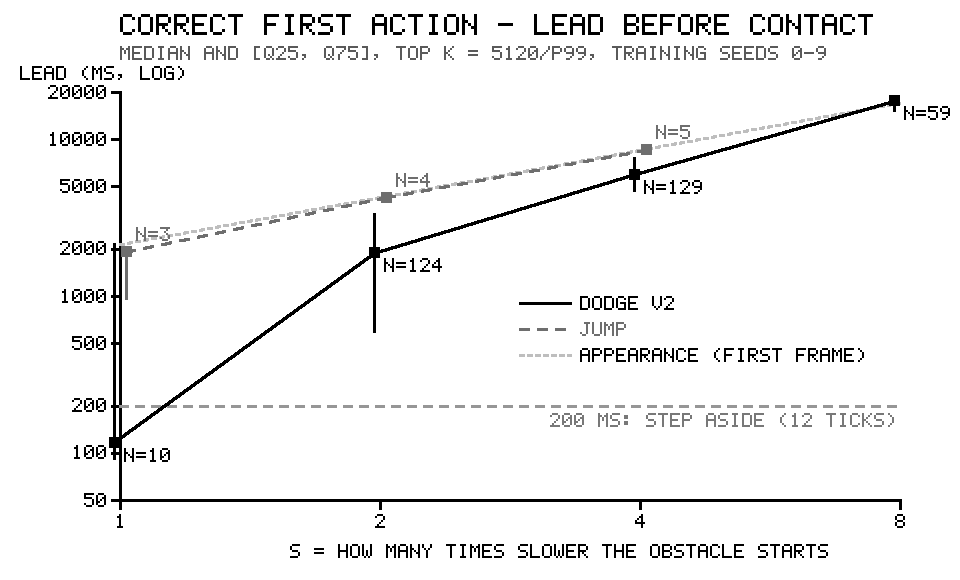

# M7g report — 느린 판: "늦게 오는 신호" 가설을 눈을 바꾸지 않고 시험

구현 세션(M3 엔진 창), 2026-10-31. 사양은 `docs/m7g-brief.md`이고, 같은 날 추가 등록 두 번(e24ea68, fc29fae)이 붙었다. 결과 원본은 `data-provenance/m7g-results.json`, 그림은 `docs/m7g-lead.png`다.

> **고지 (지시서 0절).** M7g는 초파리가 사다리 첫 칸(뛰어넘기, 피하기 v1·v2)에서 진 **뒤에** 덧붙인, 더 쉬운 칸이다. 감지기·입력 방식·해독기(`CountWindowDecoder(300 ms, 2)`)·동작점 P2·예열 5 s는 M7c2 주 팔과 같다. 바뀐 것은 장애물 출발 속도(÷`s`)와 판 길이 상한(7,200틱)뿐이다.
>
> **사후 분석 고지.** 6절의 칸 A·B는 `dodge_v2_s2` 결과를 본 뒤에 등록됐다. 이 창은 그 등록 전에 `dodge_v2_s2`의 격자 21점 학습 평균을 실행 로그에서 이미 봤다. 2~5절의 판정과 판독은 실행 전에 정한 그대로다.

## 1. 한 줄 요약

**사전 등록 판독은 5.3 표의 첫 줄, "가설을 지지한다"가 골라졌다(P1 예, P2 예).**
- P2: 피하기 v2 s4·s8에서 초파리가 무작위를 이겼다. 다만 두 판 모두 천장 점수이고, "항상 왼쪽" 봇·뇌 없는 봇·반칙 봇과 같은 점수다.

**사후 분석(칸 A·B)은 피하기에서 다른 쪽을 가리킨다.** 피하기 세 변형 모두 2×2 판독이 **"전류가 열쇠다"**다.
- 칸 A(전류는 `s = 1` 맨 위 k와 같고 시간만 김): 무작위를 이기지 못했다. s8은 두 격자점 중 하나만 이겨서 "갈림"이고, 판독 규칙대로 "못 이김"으로 셌다.
- 칸 B(시간은 `s = 1`이고 전류만 셈): 세 변형 모두 이겼다.

**통과한 장애물의 40~55 %는 출현 직후 반응에서 왔다.** 맞는 첫 행동이 장애물이 **처음 나타난 뒤 300 ms 안에** 나왔다(s8 맨 위 k 학습 판은 83 %).
- 그 몫의 점수는 다가옴이 아니라 **"나타남"에 대한 반응**에서 왔다.
- P1(앞섬 시간이 `s`와 함께 늚)이 성립한 것도 일부는 이것 때문이다. 첫 프레임에서 나온 행동의 앞섬 시간은 화면에 머무는 시간 자체이고, 그 시간은 `s`에 비례한다.

**뛰어넘기는 어느 속도, 어느 칸에서도 무작위를 이기지 못했다.**

## 2. 점수·판정표 — 평가 시드 10~19

| 변형 | s | 초파리 (선택 k, 격자 번호) | 무작위 | 고정 행동 기준 | 뇌 없는 봇 | 반칙 봇 (천장 참고) |
|---|---|---|---|---|---|---|
| 피하기 v2 | 1 | **0.0** (941.2, #10) | 0.0 | 28.8 (항상 오른쪽) | 71.2 | 69.3 |
| `dodge_v2_s2` | 2 | **10.2** (3.959e5, #20) | 0.1 | 32.0 (항상 왼쪽) | 32.0 | 32.0 |
| `dodge_v2_s4` | 4 | **14.0** (1.712e6, #20) | 0.0 | 14.0 (항상 왼쪽) | 14.0 | 14.0 |
| `dodge_v2_s8` | 8 | **6.0** (2.618e6, #18) | 0.1 | 6.0 (항상 왼쪽) | 6.0 | 6.0 |
| 뛰어넘기 | 1 | **0.0** (7.582e4, #19) | 0.6 | 0.7 (항상 점프) | 53.2 | 59.6 |
| `jump_s2` | 2 | **0.0** (2.341e4, #14) | 0.6 | 0.4 (항상 점프) | 32.2 | 32.2 |
| `jump_s4` | 4 | **0.0** (8.406e4, #15) | 0.0 | 0.2 (항상 점프) | 14.0 | 14.0 |

판정은 짝 차이 평균 ± 표준오차다. "이겼다"·"졌다"는 3 × 표준오차를 넘을 때만 쓴다.

| 변형 | 초파리 − 무작위 | 초파리 − 고정 행동 기준 | 초파리 − 뇌 없는 봇 |
|---|---|---|---|
| 피하기 v2 (s 1) | 0.00 ± 0.000 **구별 안 됨** | −28.80 ± 0.249 **졌다** | −71.20 ± 0.533 **졌다** (천장 72) |
| `dodge_v2_s2` | +10.10 ± 3.755 **구별 안 됨** (기준 11.27) | −21.80 ± 3.774 **졌다** | −21.80 ± 3.774 **졌다** (천장 — 이겼다는 판정 불가) |
| `dodge_v2_s4` | +14.00 ± 0.000 **이겼다** | 0.00 ± 0.000 **구별 안 됨** | 0.00 ± 0.000 **구별 안 됨** (천장 — 판정 불가) |
| `dodge_v2_s8` | +5.90 ± 0.100 **이겼다** | 0.00 ± 0.000 **구별 안 됨** | 0.00 ± 0.000 **구별 안 됨** (천장 — 판정 불가) |
| 뛰어넘기 (s 1) | −0.60 ± 0.306 **구별 안 됨** | −0.70 ± 0.335 **구별 안 됨** | −53.20 ± 1.298 **졌다** |
| `jump_s2` | −0.60 ± 0.400 **구별 안 됨** | −0.40 ± 0.306 **구별 안 됨** | −32.20 ± 0.249 **졌다** (천장) |
| `jump_s4` | 0.00 ± 0.000 **구별 안 됨** | −0.20 ± 0.133 **구별 안 됨** | −14.00 ± 0.000 **졌다** (천장) |

**천장.** 느린 변형 다섯 개 모두 뇌 없는 봇의 평가 점수가 반칙 봇과 10시드 전부 같다. 그래서 다섯 개 모두 "뇌 없는 봇을 이겼다"는 판정을 낼 수 없다(지시서 3절).
- 피하기 v2 느린 판에서는 **항상 한쪽으로 걷는 봇도 같은 천장 점수**를 낸다(s2 32.0, s4 14.0, s8 6.0). 플레이어가 계속 움직이면 기둥이 플레이어의 출현 시점 위치 기준으로 놓이므로 늘 비켜 간다.
- 초파리의 s4·s8 점수(14.0, 6.0)는 이 천장과 같다. "항상 왼쪽" 봇과 구별되지 않는다.

**`s = 1` 줄**은 M7c2 주 팔을 이 창의 새 기록기로 다시 돌린 것이다.
- 피하기 v2·뛰어넘기 각각 학습 210판과 평가 10판이 `m7c2-results.json`과 같다. 비교한 항목은 시드별 점수, 틱 수, 거대 신경섬유 수, 망 발화율, 점화 표시, 그리고 평가 판 장애물 기록의 M7c 칸 전부다.
- 무작위·뇌 없는 봇·반칙 봇(M7b), 항상 왼쪽·오른쪽(M7c2), `p99`(M7c)도 다시 계산해 같았다.
- "항상 아무것도 안 함"과 "항상 점프"는 M7c2에 없어서 이번에 더했다. 뛰어넘기 `s = 1`의 고정 행동 기준이 항상 점프(0.7)가 된 것은 그 때문이다.

## 3. 가설 판독 — 격자 맨 위 `k` (= 5120/p99), 학습 시드 0~9

| 변형 | s | 장애물 (열림) | 첫 행동 | 맞는 첫 행동 | **lead 중앙값** [q25, q75] ms | 방향 정답률 | away_ticks 중앙값 (≥ 12) | 통과 / 충돌 | GF 좌/우 (장애물당) |
|---|---|---|---|---|---|---|---|---|---|
| 피하기 v2 | 1 | 10 (0) | 10 | 10 | **117** [92, 2133] | 1.00 | 5.5 (0) | 0 / 10 | 4.6 / 5.6 |
| `dodge_v2_s2` | 2 | 131 (2) | 131 | 124 | **1,884** [596, 3317] | 0.95 | 24 (126) | 124 / 7 | 8.4 / 7.9 |
| `dodge_v2_s4` | 4 | 140 (10) | 140 | 129 | **5,967** [4733, 7617] | 0.92 | 54 (140) | 140 / 0 | 19.2 / 18.0 |
| `dodge_v2_s8` | 8 | 60 (10) | 60 | 59 | **17,550** [15250, 17550] | 0.98 | 120 (60) | 60 / 0 | 42.8 / 42.5 |
| 뛰어넘기 | 1 | 10 (0) | 9 | 3 | **1,917** [967, 2017] | 0.33 | — | 0 / 10 | 5.6 / 5.1 |
| `jump_s2` | 2 | 11 (0) | 11 | 4 | **4,267** [4267, 4296] | 0.36 | — | 1 / 10 | 10.6 / 9.8 |
| `jump_s4` | 4 | 10 (0) | 10 | 5 | **8,550** [8550, 8550] | 0.50 | — | 0 / 10 | 19.4 / 18.7 |

- "열림"은 2분 상한이 판을 끝낼 때 화면에 있던 장애물이다. 접촉이 없어 lead가 없다.
- 첫 행동은 장애물이 화면에 있는 동안 해독기 출력이 처음으로 NOOP가 아닌 틱이다(판독 고정 (b), 총괄 수용).

**P1(앞섬 시간): 예.** 피하기 v2는 117 → 1,884 → 5,967 → 17,550 ms(`s = 1` 대비 1 / 16 / 51 / 150배), 뛰어넘기는 1,917 → 4,267 → 8,550 ms(1 / 2.2 / 4.5배)로, 두 계열 모두 엄격히 오른다.

**P2(점수): 예.** `dodge_v2_s4`와 `dodge_v2_s8`에서 무작위를 이겼다. `dodge_v2_s2`는 +10.1이 3 × 표준오차(11.3)에 못 미친다.

**판독 (5.3 표, 첫 줄):** "늦게 오는 신호" 가설을 지지한다. 첫 칸의 패배는 회로가 못 봐서가 아니라 볼 시간이 없어서였다.

이 판독을 읽을 때 함께 봐야 할 측정 사실 세 가지가 있다. 판독을 바꾸지는 않는다.
1. **맨 위 `k`의 전류가 `s = 1`과 같지 않다**(5절). 같은 거리에서 피하기 s2/s4/s8은 2.9/6.4/11.4배, 뛰어넘기 s2/s4는 1.3/1.5배 센 전류를 받는다. 1절의 전제("같은 거리 → 같은 입력")가 측정에서 깨졌다.
2. **앞섬 시간의 상당 부분은 장애물이 처음 나타난 프레임에서 왔다**(6.3절). 첫 프레임 행동의 lead는 화면에 머문 시간 자체이고, 그 시간은 `s`에 비례한다(그림의 연회색 점선).
   - 뛰어넘기의 중앙값 4,267 ms와 8,550 ms는 그 선 위에 있다.
   - 피하기 s8의 17,550 ms도 거의 그 선이다.
3. **사후 분석 칸 A(전류는 같고 시간만 김)에서는 무작위를 이기지 못했다**(6절).



`docs/m7g-lead.png`의 구성:
- 가로축: `s`. 세로축: 맞는 첫 행동의 lead(로그). 맨 위 k, 학습 시드 기준이다.
- 표시: 중앙값과 [q25, q75], 피하기 v2(실선)와 뛰어넘기(점선)의 두 줄.
- 회색 점선: 기둥을 비키는 데 필요한 200 ms.
- 연회색 점선: 장애물 첫 프레임에서 행동했을 때의 lead(첫 속도 단계 장애물이 거리 40에서 충돌 창 앞면 1.5까지 오는 시간).

## 4. 행동이 잡음을 따르는가 (기록, 판정에 안 씀)

대조군(시드 0~19, 예열 5 s 뒤 무입력 5 s, 합계 100 s)에서 해독기는 6번 켜졌고(0.06회/s), 켜져 있던 틱은 0.2 %다.
- 그 비율로 장애물이 화면에 있는 시간 동안 잡음만으로 첫 행동이 나올 확률을 계산했다(가정: 잡음 행동이 푸아송 과정). 맨 위 k에서 그 기대 비율은 0.12~0.63이다.
- 실제로 첫 행동이 나온 비율은 0.90~1.00이다.
- 피하기 느린 판의 방향 정답률은 0.92~0.98이다. 잡음 행동이라면 0.5 근처여야 한다.

피하기 느린 판의 행동은 잡음이 아니라 자극을 따른다. 뛰어넘기는 방향 정답률이 0.33~0.50이다. 뛰어넘기의 "맞는 행동"은 점프 하나뿐이고, 좌우 한쪽만 쏘면 이동이 나온다.

## 5. `p99`와 `s` — 1절 전제의 측정

| 변형 | s | p99 | p99 × s | 맨 위 k에서 같은 거리의 전류 (`s = 1` 대비) | 맨 위 k의 출현 펄스 전류 (`s = 1` 대비) |
|---|---|---|---|---|---|
| 피하기 v2 | 1 | 0.076021 | 0.07602 | 1 | 1 |
| `dodge_v2_s2` | 2 | 0.012933 | 0.02587 | 2.94 | 5.9 |
| `dodge_v2_s4` | 4 | 0.0029901 | 0.01196 | 6.36 | 25.4 |
| `dodge_v2_s8` | 8 | 0.00083256 | 0.00666 | 11.41 | 91.3 |
| 뛰어넘기 | 1 | 0.044057 | 0.04406 | 1 | 1 |
| `jump_s2` | 2 | 0.016866 | 0.03373 | 1.31 | 2.6 |
| `jump_s4` | 4 | 0.0072007 | 0.02880 | 1.53 | 6.1 |

`p99`는 속도에 비례해 줄지 않았다. 원인은 6.2절의 거리별 비교가 보인다. 화면이 uint8로 반올림되는 효과는 크지 않았다. 0이 아닌 loom 값의 종류는 행마다 499~834개다.
- `s = 1`의 `p99`는 뇌 없는 봇이 5분 동안 장애물을 많이 지나며(피하기 v2 72개) 가속된 뒤의 빠른 장애물에서 나온다.
- 느린 판(2분)은 지나는 장애물이 적어 덜 빨라진다(가정이 아니라 6.2절 표의 "모든 장애물" 대 "첫 속도 단계" 차이로 보인다).

## 6. 사후 분석 — 시간과 전류 가르기 (추가 등록, 학습 시드 0~9)

### 6.1 칸 A·B와 2×2 판독

- **칸 A:** `k_match = s × 5120 / p99(부모)`를 끼는 격자 두 점이다(이미 돌린 판). 무작위는 그 느린 변형의 무작위 봇이다.
- **칸 B:** 부모 게임(`s = 1`, 상한 5분)에서 `k = k_top(s) / s`로 새로 돌린 50판이다. 무작위는 부모 게임의 무작위 봇이다.
- **판정:** 짝 차이 > 3 × 표준오차다. 칸 A는 두 점 모두 이기면 "이김", 하나면 "갈림"이고, 판독에서 갈림은 "못 이김"으로 친다(보충 등록).

| 변형 | 칸 | 게임 | k | 평균 | 무작위 | 짝 차이 | lead 중앙값 | away_ticks 중앙값 (≥ 12) | 통과 | 통과 중 출현 300 ms 안 |
|---|---|---|---|---|---|---|---|---|---|---|
| `dodge_v2_s2` | A #17 | dodge_v2_s2 | 1.099e5 | 0.3 | 0.1 | +0.20 ± 0.249 못 이김 | 1,367 | 3 (3) | 3 | 2 / 3 |
| | A #18 | dodge_v2_s2 | 1.685e5 | 0.1 | 0.1 | 0.00 ± 0.149 못 이김 | 233 | 5 (1) | 1 | 1 / 1 |
| | **B** | dodge_v2 | 1.979e5 | 6.4 | 0.1 | +6.30 ± 1.476 **이김** | 1,434 | 19.5 (67) | 64 | 35 / 64 (0.55) |
| | 맨 위 #20 | dodge_v2_s2 | 3.959e5 | 12.4 | 0.1 | +12.30 ± 4.546 못 이김 | 1,884 | 24 (126) | 124 | 61 / 124 (0.49) |
| `dodge_v2_s4` | A #15 | dodge_v2_s4 | 2.024e5 | 0.1 | 0.1 | 0.00 ± 0.149 못 이김 | 5,300 | 7 (2) | 1 | 0 / 1 |
| | A #16 | dodge_v2_s4 | 3.103e5 | 0.4 | 0.1 | +0.30 ± 0.260 못 이김 | 8,550 | 9.5 (4) | 4 | 4 / 4 |
| | **B** | dodge_v2 | 4.281e5 | 20.1 | 0.1 | +20.00 ± 0.632 **이김** | 1,250 | 25 (205) | 201 | 105 / 201 (0.52) |
| | 맨 위 #20 | dodge_v2_s4 | 1.712e6 | 14.0 | 0.1 | +13.90 ± 0.100 이김 | 5,967 | 54 (140) | 140 | 65 / 140 (0.46) |
| `dodge_v2_s8` | A #14 | dodge_v2_s8 | 4.743e5 | 0.4 | 0.3 | +0.10 ± 0.233 못 이김 | 12,242 | 10 (5) | 4 | 3 / 4 |
| | A #15 | dodge_v2_s8 | 7.27e5 | 2.5 | 0.3 | +2.20 ± 0.573 **이김** | 16,175 | 15.5 (27) | 25 | 13 / 25 (0.52) |
| | **B** | dodge_v2 | 7.687e5 | 32.6 | 0.1 | +32.50 ± 1.078 **이김** | 717 | 25 (332) | 326 | 153 / 326 (0.47) |
| | 맨 위 #20 | dodge_v2_s8 | 6.15e6 | 6.0 | 0.3 | +5.70 ± 0.153 이김 | 17,550 | 120 (60) | 60 | 50 / 60 (0.83) |
| `jump_s2` | A #19 | jump_s2 | 1.981e5 | 0.0 | 0.5 | −0.50 ± 0.167 못 이김 | 4,267 | — | 0 | — |
| | A #20 | jump_s2 | 3.036e5 | 0.1 | 0.5 | −0.40 ± 0.221 못 이김 | 4,267 | — | 1 | 1 / 1 |
| | B | jump | 1.518e5 | 0.1 | 1.2 | −1.10 ± 0.482 못 이김 | 1,917 | — | 1 | 1 / 1 |
| `jump_s4` | A #19 | jump_s4 | 4.639e5 | 0.1 | 0.2 | −0.10 ± 0.233 못 이김 | 8,550 | — | 1 | 1 / 1 |
| | A #20 | jump_s4 | 7.11e5 | 0.0 | 0.2 | −0.20 ± 0.200 못 이김 | 8,550 | — | 0 | — |
| | B | jump | 1.778e5 | 0.0 | 1.2 | −1.20 ± 0.442 못 이김 | 2,133 | — | 0 | — |

뛰어넘기의 맨 위 k 줄은 칸 A #20과 같은 판이라 따로 적지 않았다.

| 변형 | `k_match` | 칸 A | 칸 B | **2×2 판독** |
|---|---|---|---|---|
| `dodge_v2_s2` | 1.347e5 | 못 이김 | 이김 | 전류가 열쇠다. 첫 칸의 `k` 격자 꼭대기가 낮았던 것이지, 신호가 늦어서가 아니다 |
| `dodge_v2_s4` | 2.694e5 | 못 이김 | 이김 | 전류가 열쇠다. 첫 칸의 `k` 격자 꼭대기가 낮았던 것이지, 신호가 늦어서가 아니다 |
| `dodge_v2_s8` | 5.388e5 | 갈림 → 못 이김 | 이김 | 전류가 열쇠다. 첫 칸의 `k` 격자 꼭대기가 낮았던 것이지, 신호가 늦어서가 아니다 |
| `jump_s2` | 2.324e5 | 못 이김 | 못 이김 | 느린 판의 승리는 시간과 센 전류가 함께 있을 때만 나온다 |
| `jump_s4` | 4.649e5 | 못 이김 | 못 이김 | 느린 판의 승리는 시간과 센 전류가 함께 있을 때만 나온다 |

**뛰어넘기 두 줄의 문장은 표가 고른 것이지만, 뛰어넘기에는 설명할 "느린 판의 승리"가 없다.** 맨 위 k에서도 칸 A·B에서도 무작위를 이기지 못했다.

**칸 B의 전류는 첫 칸 격자 밖이다.** `s = 1` 격자 꼭대기(k × p99 = 5,120)의 3~11배다(k × p99(부모) = 15,040 / 32,540 / 58,440). 칸 B 50판에 점화(`like_for_like`)·폭주·뷰어 실패는 없다.

### 6.2 근사 확인 — 거리 구간별 평균 loom, (느린 변형 × s) / (`s = 1`)

칸 A·B의 "같은 전류"는 틱당 loom ∝ 1/`s` 근사에 기댄다. 표의 값이 1이면 맞는 것이다.
- 첫 표는 "항상 아무것도 안 함" 봇의 프레임이다. 움직이지 않으므로 다가옴의 기하만 보인다. 등록할 때 말한 표에 더해 함께 실었다.
- 아래 두 표는 등록대로 `p99`를 낸 프레임(그 변형 θ의 뇌 없는 봇)이다.

| 거리 | `dodge_v2_s2` | `dodge_v2_s4` | `dodge_v2_s8` | `jump_s2` | `jump_s4` |
|---|---|---|---|---|---|
| **첫 프레임 (출현, d = 40)** | **2.00** | **4.00** | **8.00** | **2.00** | **4.00** |
| 40–20 | 1.01 | 1.01 | 1.02 | 1.02 | 1.09 |
| 20–10 | 1.01 | 1.00 | 1.01 | 1.01 | 1.00 |
| 10–5 | 1.05 | 1.04 | 1.06 | 1.05 | 1.04 |
| 5–3 | 1.04 | 1.08 | 1.09 | 1.04 | 1.09 |
| 3–2 | 1.04 | 1.06 | 1.08 | 1.12 | 1.16 |
| 2–1.5 | 1.09 | 1.16 | 1.18 | 1.11 | 1.19 |

뇌 없는 봇, 첫 속도 단계(판의 처음 장애물 4개):

| 거리 | `dodge_v2_s2` | `dodge_v2_s4` | `dodge_v2_s8` | `jump_s2` | `jump_s4` |
|---|---|---|---|---|---|
| 첫 프레임 | 2.00 | 4.00 | 8.00 | 2.00 | 4.00 |
| 40–20 | 1.01 | 1.01 | 1.02 | 1.02 | 1.09 |
| 20–10 | 1.01 | 1.00 | 1.01 | 1.01 | 1.00 |
| 10–5 | 1.05 | 1.04 | 1.06 | 1.05 | 1.04 |
| 5–3 | 0.60 | 0.47 | 0.14 | 1.04 | 1.09 |
| 3–2 / 2–1.5 / 1.5–0.5 | — | — | — | 1.12 / 1.11 / 1.13 | 1.16 / 1.19 / 1.03 |

뇌 없는 봇, 모든 장애물:

| 거리 | `dodge_v2_s2` | `dodge_v2_s4` | `dodge_v2_s8` | `jump_s2` | `jump_s4` |
|---|---|---|---|---|---|
| 40–20 | 0.64 | 0.49 | 0.44 | 0.80 | 0.64 |
| 20–10 | 0.68 | 0.52 | 0.47 | 0.83 | 0.64 |
| 10–5 | 0.75 | 0.58 | 0.52 | 0.85 | 0.67 |
| 5–3 | 0.54 | 0.24 | 0.06 | 0.85 | 0.69 |

- **다가오는 동안의 근사는 맞는다.** 움직이지 않는 봇의 프레임에서 거리 40~3은 0~9 %, 3~1.5는 4~19 % 안에서 맞는다. 가까울수록 `s = 1`의 틱당 걸음이 거칠어 어긋남이 커진다.
- **출현 펄스는 맞지 않는다.** 장애물이 처음 나타나는 프레임의 loom(피하기 8.33e-4, 뛰어넘기 1.02e-4)은 `s`와 상관없이 같다. 그래서 × `s` 하면 정확히 `s`배가 된다.
  - 칸 A에서는 출현 펄스 전류가 `s = 1` 맨 위 k의 `s`배다.
  - 칸 B에서는 그 느린 변형 맨 위 k의 1/`s`배다.
- **뇌 없는 봇의 "모든 장애물" 값이 1보다 작은 이유:** `s = 1` 판의 뒤쪽 장애물이 가속돼 있기 때문이다. 첫 속도 단계만 보면 1로 돌아온다. 이것이 5절에서 `p99 × s`가 일정하지 않은 원인이다.
- 피하기 5~3 이하에서 값이 벌어지는 것은 봇이 이미 비켜서 기둥이 반쪽 화면에서 빠지기 때문이다. 기하가 아니라 봇의 움직임 차이다.

### 6.3 출현 펄스 — 통과 중 맞는 첫 행동이 출현 300 ms 안에 나온 비율 (기술용, 판독에 안 씀)

300 ms는 해독기 창 W다. 첫 프레임의 펄스가 거대 신경섬유를 한 발 쏘게 하면, 그 한 발이 300 ms 동안 해독기 창에 남아 다른 한 발과 짝을 이룰 수 있다.

| 변형 | 어디 | 맞는 첫 행동 (300 ms 안 / 뒤) | lead 중앙값 안 / 뒤 (ms) | 통과 | **통과 중 300 ms 안** |
|---|---|---|---|---|---|
| `dodge_v2_s2` | 맨 위 k = 선택 k, 학습 | 124 (61 / 63) | 3,317 / 600 | 124 | **61 (0.49)** |
| | 선택 k, 평가 | 100 (50 / 50) | 3,317 / 600 | 102 | **50 (0.49)** |
| `dodge_v2_s4` | 맨 위 k = 선택 k, 학습 | 129 (65 / 64) | 7,616 / 4,642 | 140 | **65 (0.46)** |
| | 선택 k, 평가 | 126 (68 / 58) | 7,617 / 4,542 | 140 | **68 (0.49)** |
| `dodge_v2_s8` | 맨 위 k, 학습 | 59 (50 / 9) | 17,550 / 14,983 | 60 | **50 (0.83)** |
| | 선택 k, 학습 | 53 (24 / 29) | 17,550 / 12,366 | 60 | **24 (0.40)** |
| | 선택 k, 평가 | 52 (25 / 27) | 17,284 / 13,716 | 60 | **25 (0.42)** |
| 칸 B (피하기 s2 / s4 / s8의 k) | 부모 게임, 학습 | — | — | 64 / 201 / 326 | **0.55 / 0.52 / 0.47** |
| 칸 A (피하기) | 학습 | — | — | 3·1 / 1·4 / 4·25 | 2/3·1/1 / 0/1·4/4 / 3/4·13/25 |

`s = 1` 피하기 v2 맨 위 k에서도 맞는 첫 행동 10개 중 4개가 출현 첫 틱에 나왔다(통과는 0).
- 시드 9와 4를 다시 돌려 확인했다. 첫 프레임 입력 5 ms 뒤 같은 쪽 GF가 한 발 쏘고, 그 전 300 ms 안의 자발 한 발과 합쳐져 해독기가 켜졌다.
- 뛰어넘기는 통과가 거의 없어 이 비율이 의미가 없다(맨 위 k 맞는 첫 행동 3 / 4 / 5개 중 출현 300 ms 안 2 / 4 / 4개).

**읽기(측정 사실).** 피하기 느린 판에서 통과한 장애물의 40~55 %는 맞는 첫 행동이 출현 300 ms 안에 나왔다(s8 맨 위 k 학습 판은 83 %). **그 몫의 점수는 다가옴이 아니라 "나타남"에 대한 반응에서 왔다.**
- 나머지 통과는 출현 300 ms 뒤의 맞는 첫 행동에서 왔다. 그 lead 중앙값은 s2 0.6 s, s4 4.5~4.6 s, s8 12.4~15.0 s로, 비키는 데 필요한 200 ms보다 길다.
- 이 나머지도 `s = 1` 맨 위 k보다 센 전류(5절, 2.9~11.4배)에서 나왔다.
- 이 반응이 다가옴의 "시간" 때문인지는 칸 A가 답한다. 칸 A에서는 통과가 거의 없다(피하기 s2 3·1, s4 1·4, s8 4·25).

## 7. 점화와 실패 조건 (판은 빼지 않고 표시만)

| | `like_for_like` (표에 인용) | `literal` (기록용) | 폭주 | 뷰어 실패 |
|---|---|---|---|---|
| 평가 70판 (7행 × 10) | 0 | 70 | 0 | 0 |
| 학습 격자 1,470판 (7행 × 210) | 0 | 1,470 | 0 | 0 |
| 칸 B 50판 | 0 | — | 0 | 0 |

- 평가 판의 창(200 ms) 최대 활성은 8.1~11.5 %, 창 최대 망 발화율은 0.58 Hz 이하다. `like_for_like` 초과분은 −0.15 ~ +0.26 %p다(기준 1 %p).
- `literal`이 모든 판에 걸리는 이유는 M7c2 보고서 4절과 같다. 판의 창 최댓값을 대조군의 창 평균과 비교하기 때문이다.
- **판 전체 누적 활성 비율은 2분짜리 판에서 거의 1.0이 된다**(평가 `active_fraction`: 피하기 s4·s8 1.0, s2 0.69~1.0). 망 평균 0.28 Hz의 배경 발화가 2분 쌓인 결과다.
  - 뷰어의 실패 경고는 매 프레임의 활성 뉴런 수로 계산하므로(`flysim-viewer.html`, 감쇠 흔적 > 0.004), 이것과 다르다.
  - 창 단위 최대 활성은 위와 같이 12 % 아래다.
- 대조군 20시드는 `m7c2-results.json`과 같다.

## 8. 비교 봇과 θ

| 변형 | θ (학습 평균, 동률 수) | 반칙 봇 | 고정 행동 4개 평균 (NOOP / JUMP / LEFT / RIGHT) |
|---|---|---|---|
| 피하기 v2 (s 1) | 1.259e-4 (M7b 값) | 69.3 | 0.0 / 0.0 / 28.6 / 28.8 |
| `dodge_v2_s2` | 1.585e-4 (32.3, 25) | 32.0 | 0.0 / 0.0 / 32.0 / 32.0 |
| `dodge_v2_s4` | 2.512e-4 (14.0, 30) | 14.0 | 0.0 / 0.0 / 14.0 / 14.0 |
| `dodge_v2_s8` | 1.995e-4 (6.0, 28) | 6.0 | 0.0 / 0.0 / 6.0 / 6.0 |
| 뛰어넘기 (s 1) | 1.585e-4 (M7b 값) | 59.6 | 0.0 / 0.7 / 0.0 / 0.0 |
| `jump_s2` | 6.310e-4 (32.1, 8) | 32.2 | 0.0 / 0.4 / 0.0 / 0.0 |
| `jump_s4` | 1.585e-3 (14.0, 6) | 14.0 | 0.0 / 0.2 / 0.0 / 0.0 |

반칙 봇은 `StateOracleAgent`의 규칙 그대로다. 느린 변형에는 `SlowStateOracle`이 게임을 부모 이름으로 보여 준다. 원본 이름 검사 때문이며 규칙은 바꾸지 않았다(지시서 3절).

## 9. 재생 묶음 (평가 시드 10, 선택 k)

| 경로 | 점수 | 판 길이 | 묶음 길이 | 끝 | 크기 |
|---|---|---|---|---|---|
| `runs/m7g/dodge_v2_s2-brain-seed10/` | 13 | 63.3 s | 60 s | 충돌 (late) | 37 MB |
| `runs/m7g/dodge_v2_s4-brain-seed10/` | 14 | 120 s (상한) | 60 s | 상한 | 37 MB |
| `runs/m7g/dodge_v2_s8-brain-seed10/` | 6 | 120 s (상한) | 60 s | 상한 | 37 MB |
| `runs/m7g/jump_s2-brain-seed10/` | 0 | 5.4 s | 5.4 s | 충돌 (반응 없음) | 5.1 MB |
| `runs/m7g/jump_s4-brain-seed10/` | 0 | 9.7 s | 9.7 s | 충돌 (반응 없음) | 7.4 MB |

- 형식은 M7c2와 같다(`frames.npz`, `run.json`, `game.json`). 묶음은 M7c 규칙대로 처음 60 s까지다.
- `game.json`의 `rules`는 그 변형의 규칙이다(`SPEED0`, `speed_divisor`, `max_ticks`, `parent`). `run.json`의 `meta`에 `m7g_row`, `speed_divisor`, `warmup_steps`가 있다.
- 재생 점수가 평가 점수와 같은지 실행 중에 확인했다.

## 10. 지시서와 다른 점·구현 결정

1. **판독 고정 (a)~(d)** — 느린 판을 돌리기 전에 코드에 고정했고, 총괄이 수용했다.
   - (a) 5.2 표는 맨 위 k의 학습 시드 0~9로 낸다.
   - (b) 첫 행동은 해독기 출력 기준이다. 피하기의 JUMP는 틀린 첫 행동이다.
   - (c) P1은 두 계열 모두 엄격히 올라야 참이다. 중앙값이 없는 칸이 있으면 오르지 않은 것으로 본다.
   - (d) P2는 느린 변형 하나 이상에서 무작위를 이길 때 참이다.
2. **기록기는 이 창의 `m7g.play`다.** `m7c.play_fly`는 `base.make`로 게임을 만들어 느린 변형을 모른다(그리고 `base.make`는 고치지 않는다).
   - M7c와 겹치는 칸은 같은 계산이다. 가짜 뇌(CPU)와 실제 뇌(GPU) 테스트에서 `play_fly`와 같은 결과를 확인했다.
   - `s = 1` 재실행에서도 M7c2 평가 판 장애물 기록과 칸마다 같았다.
   - 재생 묶음도 같은 이유로 `m7g.write_bundle`이 쓴다(M7c 형식, `rules`만 변형의 것).
3. **`s = 1`의 비교 봇:** 지시서대로 M7b·M7c2 점수를 쓰고, 다시 돌려 시드별로 같은지 확인했다. 고정 행동 봇 4개 중 M7c2에 없던 둘(아무것도 안 함, 점프)은 새로 돌렸다.
4. **`s = 1`의 천장:** M7c의 사전 등록(피하기 v2 72)을 그대로 쓴다. 느린 변형에는 지시서 3절 규칙(뇌 없는 봇 = 반칙 봇, 10시드 전부)을 쓴다. `s = 1` 피하기 v2는 새 규칙으로는 천장이 아니다(뇌 없는 봇 71.2, 반칙 봇 69.3).
5. **`jump_s4`의 k 선택:** 학습 최고 평균 0.1이 #15와 #19 두 점에서 나왔다. 기하 중앙(#17)에서 두 점의 거리가 같아, `m7c.select_best`가 앞의 점(#15)을 골랐다(M7c 함수 그대로).
6. **GPU 두 프로세스:** 시간 측정 뒤 나머지 네 변형을 두 프로세스로 나눠 돌렸다. GPU가 이미 포화라 벽시계 이득은 거의 없었다. 결과는 프로세스마다 결정론적이다(`s = 1` 재현과 결정론 테스트).
7. **실행 조각(parts):** 단계별 결과를 `runs/m7g/parts/`에 쓰고, 조립할 때 코드의 sha256이 모두 같은지 확인한다.
   - `m7g.py`는 "presentation" 표시 위쪽(실험 코드)만 해시에 넣는다. 그래서 표·그림 코드를 고쳐도 판을 다시 돌리지 않는다.
   - 다른 창이 실행 중에 `base.py`의 `base.make` 등록표에 이름을 더했다(M7f1). 이 실험은 `base.make`를 부르지 않으므로 기록만 했다(`part_sources_base_py`).
   - 조각의 `git.modified` 목록은 첫 경로의 첫 글자가 잘려 있다("lysim/..."). 출력 전체에 strip을 건 탓이다. 조각은 쓴 그대로 두고, 결과 파일의 `git`은 바로잡은 함수로 냈다.
8. **사후 분석(추가 등록):** 칸 B 50판과 근사 확인은 `--stage posthoc`이 돌린다(`m7g.py`의 presentation 표시 아래 구역, 조각에 파일 전체 sha256을 기록).
   - 근사 확인에는 등록한 뇌 없는 봇 프레임에 더해 "항상 아무것도 안 함" 봇 프레임 표를 함께 실었다. 다가옴의 기하만 보려는 것이다.
9. **결과 파일 크기:** 1.33 MB다. 모든 장애물 기록(7행 × 220판, 압축 열 형식)을 넣었기 때문이다. 다른 판독도 판을 다시 돌리지 않고 계산할 수 있게 하려는 것이다.
10. **그림의 세로축은 로그다.** `s = 1`의 117 ms와 200 ms 선을 구별해 보이게 하려는 것이다. 연회색 출현 선(첫 프레임 행동의 lead)을 더 그렸다.

## 11. 재현

```
.venv/bin/python -m flysim.apps.games.m7g --stage bots       # CPU 2.5분: θ, p99, 비교 봇 (s = 1 대조 포함)
.venv/bin/python -m flysim.apps.games.m7g --stage controls   # GPU 13 s: 대조군 20 (m7c2와 대조)
.venv/bin/python -m flysim.apps.games.m7g --stage fly        # GPU 약 1시간: 7행 × (학습 210 + 평가 10) + 묶음 5
.venv/bin/python -m flysim.apps.games.m7g --stage posthoc    # 추가 등록: 칸 B 50판 + 근사 확인, 2.5분
.venv/bin/python -m flysim.apps.games.m7g --stage assemble   # 결과 json, docs/m7g-lead.png, runs/m7g/tables.md
.venv/bin/python -m pytest tests/ -q
```

- 실행 시간(벽시계): 피하기 v2 `s = 1` 122 s, 뛰어넘기 `s = 1` 114 s, `dodge_v2_s2` 232 s.
- 두 프로세스로 동시에 돌린 넷: `dodge_v2_s4` 1,002 s, `dodge_v2_s8` 1,531 s, `jump_s2` 144 s, `jump_s4` 393 s. 시뮬 시간은 합계 약 9시간 분량이다.
- 같은 시드 → 같은 점수·같은 스파이크다(`test_a_slow_fly_episode_is_deterministic`, `s = 1` 재현).
- `pytest tests/`: 653 passed, 2 skipped(작업 트리 기준. 건너뛴 둘은 `test_show_html.py`의 실제 묶음 전용 검사). 이 실험의 테스트는 `tests/test_m7g.py` 27개다.

## 부록 — 모든 `k`의 장애물 표 (학습 시드 0~9)

열:
- 장애물 수(열림), 첫 행동, 맞는 첫 행동, 맞는 첫 행동의 lead 중앙값, 방향 정답률, away_ticks 중앙값
- GF 좌/우(장애물당)
- 첫 행동 비율 대 잡음 기대값(가정: 대조군 해독기 켜짐을 푸아송 과정으로)


### dodge_v2

| # | k | k×p99 | 학습 평균 | 장애물 (열림) | 첫 행동 | 맞는 첫 행동 | lead 중앙값 ms | 방향 정답률 | away 중앙값 | GF 좌/우 | 첫 행동 비율 대 잡음 |
|---|---|---|---|---|---|---|---|---|---|---|---|
| 0 | 13.15 | 1 | 0.0 | 10 (0) | 2 | 1 | 1767 | 0.50 | 0 | 4.30/4.20 | 0.20 vs 0.12 |
| 1 | 20.16 | 1.533 | 0.0 | 10 (0) | 2 | 1 | 1767 | 0.50 | 0 | 4.30/4.20 | 0.20 vs 0.12 |
| 2 | 30.9 | 2.349 | 0.0 | 10 (0) | 2 | 1 | 1767 | 0.50 | 0 | 4.30/4.20 | 0.20 vs 0.12 |
| 3 | 47.36 | 3.601 | 0.0 | 10 (0) | 2 | 1 | 1767 | 0.50 | 0 | 4.30/4.30 | 0.20 vs 0.12 |
| 4 | 72.6 | 5.519 | 0.0 | 10 (0) | 2 | 1 | 1767 | 0.50 | 0 | 4.30/4.30 | 0.20 vs 0.12 |
| 5 | 111.3 | 8.459 | 0.0 | 10 (0) | 3 | 1 | 1767 | 0.33 | 0 | 4.40/4.50 | 0.30 vs 0.12 |
| 6 | 170.5 | 12.97 | 0.0 | 10 (0) | 4 | 2 | 883.5 | 0.50 | 0 | 4.40/4.60 | 0.40 vs 0.12 |
| 7 | 261.4 | 19.87 | 0.0 | 10 (0) | 4 | 1 | 1767 | 0.25 | 0 | 4.40/4.50 | 0.40 vs 0.12 |
| 8 | 400.7 | 30.46 | 0.0 | 10 (0) | 3 | 1 | 1767 | 0.33 | 0 | 4.30/4.40 | 0.30 vs 0.12 |
| 9 | 614.1 | 46.68 | 0.0 | 10 (0) | 1 | 1 | 1767 | 1.00 | 0 | 4.20/4.30 | 0.10 vs 0.12 |
| 10 | 941.2 | 71.55 | 0.0 | 10 (0) | 2 | 1 | 1767 | 0.50 | 0 | 4.30/4.30 | 0.20 vs 0.12 |
| 11 | 1443 | 109.7 | 0.0 | 10 (0) | 3 | 2 | 1491.5 | 0.67 | 0 | 4.20/4.20 | 0.30 vs 0.12 |
| 12 | 2211 | 168.1 | 0.0 | 10 (0) | 3 | 2 | 1491.5 | 0.67 | 0 | 4.30/4.00 | 0.30 vs 0.12 |
| 13 | 3389 | 257.6 | 0.0 | 10 (0) | 4 | 4 | 33.5 | 1.00 | 0 | 4.60/4.80 | 0.40 vs 0.12 |
| 14 | 5195 | 394.9 | 0.0 | 10 (0) | 3 | 3 | 150 | 1.00 | 0 | 4.40/4.70 | 0.30 vs 0.12 |
| 15 | 7962 | 605.3 | 0.0 | 10 (0) | 3 | 3 | 150 | 1.00 | 0 | 4.30/4.40 | 0.30 vs 0.12 |
| 16 | 1.22e+04 | 927.7 | 0.0 | 10 (0) | 6 | 6 | 17 | 1.00 | 1 | 4.50/5.00 | 0.60 vs 0.12 |
| 17 | 1.87e+04 | 1422 | 0.0 | 10 (0) | 6 | 5 | 1917 | 0.83 | 1 | 4.60/4.90 | 0.60 vs 0.12 |
| 18 | 2.867e+04 | 2179 | 0.0 | 10 (0) | 6 | 5 | 2133 | 0.83 | 0.5 | 5.00/5.30 | 0.60 vs 0.12 |
| 19 | 4.394e+04 | 3340 | 0.0 | 10 (0) | 9 | 8 | 1716.5 | 0.89 | 4 | 5.20/5.50 | 0.90 vs 0.12 |
| 20 | 6.735e+04 | 5120 | 0.0 | 10 (0) | 10 | 10 | 117 | 1.00 | 5.5 | 4.60/5.60 | 1.00 vs 0.12 |

### dodge_v2_s2

| # | k | k×p99 | 학습 평균 | 장애물 (열림) | 첫 행동 | 맞는 첫 행동 | lead 중앙값 ms | 방향 정답률 | away 중앙값 | GF 좌/우 | 첫 행동 비율 대 잡음 |
|---|---|---|---|---|---|---|---|---|---|---|---|
| 0 | 77.32 | 1 | 0.0 | 10 (0) | 2 | 1 | 3900 | 0.50 | 0 | 8.30/8.20 | 0.20 vs 0.23 |
| 1 | 118.5 | 1.533 | 0.0 | 10 (0) | 2 | 1 | 3900 | 0.50 | 0 | 8.40/8.20 | 0.20 vs 0.23 |
| 2 | 181.6 | 2.349 | 0.0 | 10 (0) | 2 | 1 | 3900 | 0.50 | 0 | 8.30/8.40 | 0.20 vs 0.23 |
| 3 | 278.4 | 3.601 | 0.0 | 10 (0) | 2 | 1 | 3900 | 0.50 | 0 | 8.30/8.30 | 0.20 vs 0.23 |
| 4 | 426.7 | 5.519 | 0.0 | 10 (0) | 4 | 2 | 2008.5 | 0.50 | 0 | 8.30/8.30 | 0.40 vs 0.23 |
| 5 | 654.1 | 8.459 | 0.0 | 10 (0) | 2 | 1 | 3900 | 0.50 | 0 | 8.20/8.20 | 0.20 vs 0.23 |
| 6 | 1002 | 12.97 | 0.0 | 10 (0) | 3 | 1 | 3900 | 0.33 | 0 | 8.10/8.20 | 0.30 vs 0.23 |
| 7 | 1537 | 19.87 | 0.0 | 10 (0) | 4 | 2 | 1975 | 0.50 | 0 | 8.20/8.00 | 0.40 vs 0.23 |
| 8 | 2355 | 30.46 | 0.0 | 10 (0) | 5 | 2 | 1966.5 | 0.40 | 0 | 8.60/8.40 | 0.50 vs 0.23 |
| 9 | 3610 | 46.68 | 0.0 | 10 (0) | 2 | 1 | 3900 | 0.50 | 0 | 8.30/8.30 | 0.20 vs 0.23 |
| 10 | 5533 | 71.55 | 0.0 | 10 (0) | 6 | 4 | 1900 | 0.67 | 0.5 | 8.50/8.60 | 0.60 vs 0.23 |
| 11 | 8480 | 109.7 | 0.0 | 10 (0) | 4 | 3 | 0 | 0.75 | 0 | 8.40/8.40 | 0.40 vs 0.23 |
| 12 | 1.3e+04 | 168.1 | 0.0 | 10 (0) | 5 | 4 | 308 | 0.80 | 0 | 9.20/8.90 | 0.50 vs 0.23 |
| 13 | 1.992e+04 | 257.6 | 0.0 | 10 (0) | 8 | 6 | 4250 | 0.75 | 1 | 9.10/9.20 | 0.80 vs 0.23 |
| 14 | 3.053e+04 | 394.9 | 0.0 | 10 (0) | 8 | 6 | 3566.5 | 0.75 | 1.5 | 9.00/9.20 | 0.80 vs 0.23 |
| 15 | 4.68e+04 | 605.3 | 0.0 | 10 (0) | 9 | 8 | 4149.5 | 0.89 | 4 | 9.20/9.70 | 0.90 vs 0.23 |
| 16 | 7.173e+04 | 927.7 | 0.1 | 11 (0) | 9 | 7 | 4266 | 0.78 | 6 | 9.27/9.82 | 0.82 vs 0.23 |
| 17 | 1.099e+05 | 1422 | 0.3 | 13 (0) | 13 | 12 | 1366.5 | 0.92 | 3 | 9.23/10.00 | 1.00 vs 0.23 |
| 18 | 1.685e+05 | 2179 | 0.1 | 11 (0) | 11 | 9 | 233 | 0.82 | 5 | 9.18/10.73 | 1.00 vs 0.23 |
| 19 | 2.583e+05 | 3340 | 0.1 | 11 (0) | 11 | 9 | 1383 | 0.82 | 7 | 9.91/10.36 | 1.00 vs 0.23 |
| 20 | 3.959e+05 | 5120 | 12.4 | 131 (2) | 131 | 124 | 1883.5 | 0.95 | 24 | 8.40/7.88 | 1.00 vs 0.17 |

### dodge_v2_s4

| # | k | k×p99 | 학습 평균 | 장애물 (열림) | 첫 행동 | 맞는 첫 행동 | lead 중앙값 ms | 방향 정답률 | away 중앙값 | GF 좌/우 | 첫 행동 비율 대 잡음 |
|---|---|---|---|---|---|---|---|---|---|---|---|
| 0 | 334.4 | 1 | 0.0 | 10 (0) | 6 | 1 | 8184 | 0.17 | 0 | 16.60/16.40 | 0.60 vs 0.40 |
| 1 | 512.6 | 1.533 | 0.0 | 10 (0) | 5 | 1 | 8184 | 0.20 | 0 | 16.50/16.50 | 0.50 vs 0.40 |
| 2 | 785.7 | 2.349 | 0.0 | 10 (0) | 7 | 1 | 8184 | 0.14 | 0 | 17.10/16.80 | 0.70 vs 0.40 |
| 3 | 1204 | 3.601 | 0.0 | 10 (0) | 5 | 1 | 8184 | 0.20 | 0 | 16.80/16.50 | 0.50 vs 0.40 |
| 4 | 1846 | 5.519 | 0.0 | 10 (0) | 4 | 1 | 8184 | 0.25 | 0 | 16.60/16.70 | 0.40 vs 0.40 |
| 5 | 2829 | 8.459 | 0.0 | 10 (0) | 4 | 1 | 8184 | 0.25 | 0 | 16.40/16.50 | 0.40 vs 0.40 |
| 6 | 4336 | 12.97 | 0.0 | 10 (0) | 6 | 2 | 4117 | 0.33 | 0 | 16.50/16.40 | 0.60 vs 0.40 |
| 7 | 6646 | 19.87 | 0.0 | 10 (0) | 5 | 2 | 300 | 0.40 | 0 | 16.50/16.10 | 0.50 vs 0.40 |
| 8 | 1.019e+04 | 30.46 | 0.0 | 10 (0) | 5 | 4 | 1192 | 0.80 | 0 | 16.40/16.70 | 0.50 vs 0.40 |
| 9 | 1.561e+04 | 46.68 | 0.0 | 10 (0) | 4 | 3 | 8333 | 0.75 | 0 | 17.10/16.90 | 0.40 vs 0.40 |
| 10 | 2.393e+04 | 71.55 | 0.0 | 10 (0) | 5 | 4 | 8550 | 0.80 | 0.5 | 16.80/17.00 | 0.50 vs 0.40 |
| 11 | 3.668e+04 | 109.7 | 0.0 | 10 (0) | 8 | 6 | 8550 | 0.75 | 3 | 17.00/17.50 | 0.80 vs 0.40 |
| 12 | 5.622e+04 | 168.1 | 0.2 | 12 (0) | 9 | 7 | 8550 | 0.78 | 5 | 17.42/17.08 | 0.75 vs 0.40 |
| 13 | 8.617e+04 | 257.6 | 0.1 | 11 (0) | 8 | 6 | 8550 | 0.75 | 4 | 17.45/18.27 | 0.73 vs 0.40 |
| 14 | 1.321e+05 | 394.9 | 0.0 | 10 (0) | 9 | 9 | 2366 | 1.00 | 6.5 | 17.70/18.50 | 0.90 vs 0.40 |
| 15 | 2.024e+05 | 605.3 | 0.1 | 11 (0) | 11 | 10 | 5300 | 0.91 | 7 | 18.27/19.00 | 1.00 vs 0.40 |
| 16 | 3.103e+05 | 927.7 | 0.4 | 14 (0) | 14 | 10 | 8550 | 0.71 | 9.5 | 18.07/19.29 | 1.00 vs 0.40 |
| 17 | 4.756e+05 | 1422 | 2.5 | 35 (0) | 35 | 34 | 4933 | 0.97 | 16 | 18.37/18.34 | 1.00 vs 0.39 |
| 18 | 7.289e+05 | 2179 | 7.4 | 80 (4) | 80 | 72 | 5666.5 | 0.90 | 22 | 18.04/17.09 | 1.00 vs 0.37 |
| 19 | 1.117e+06 | 3340 | 13.1 | 132 (9) | 132 | 113 | 5767 | 0.86 | 35 | 18.59/17.27 | 1.00 vs 0.36 |
| 20 | 1.712e+06 | 5120 | 14.0 | 140 (10) | 140 | 129 | 5967 | 0.92 | 54 | 19.22/18.04 | 1.00 vs 0.36 |

### dodge_v2_s8

| # | k | k×p99 | 학습 평균 | 장애물 (열림) | 첫 행동 | 맞는 첫 행동 | lead 중앙값 ms | 방향 정답률 | away 중앙값 | GF 좌/우 | 첫 행동 비율 대 잡음 |
|---|---|---|---|---|---|---|---|---|---|---|---|
| 0 | 1201 | 1 | 0.0 | 10 (0) | 6 | 2 | 8983.5 | 0.33 | 0 | 32.70/32.60 | 0.60 vs 0.64 |
| 1 | 1841 | 1.533 | 0.0 | 10 (0) | 6 | 1 | 16734 | 0.17 | 0 | 32.90/32.50 | 0.60 vs 0.64 |
| 2 | 2822 | 2.349 | 0.0 | 10 (0) | 6 | 1 | 16734 | 0.17 | 0 | 32.60/32.50 | 0.60 vs 0.64 |
| 3 | 4325 | 3.601 | 0.0 | 10 (0) | 8 | 2 | 8658.5 | 0.25 | 0 | 33.00/32.90 | 0.80 vs 0.64 |
| 4 | 6629 | 5.519 | 0.0 | 10 (0) | 8 | 0 | — | 0.00 | 0 | 32.80/32.70 | 0.80 vs 0.64 |
| 5 | 1.016e+04 | 8.459 | 0.0 | 10 (0) | 5 | 1 | 1083 | 0.20 | 0 | 32.40/32.70 | 0.50 vs 0.64 |
| 6 | 1.557e+04 | 12.97 | 0.0 | 10 (0) | 5 | 4 | 1866.5 | 0.80 | 0 | 32.40/33.20 | 0.50 vs 0.64 |
| 7 | 2.387e+04 | 19.87 | 0.1 | 11 (0) | 9 | 4 | 17100 | 0.44 | 1 | 34.09/33.55 | 0.82 vs 0.64 |
| 8 | 3.658e+04 | 30.46 | 0.0 | 10 (0) | 9 | 8 | 15758.5 | 0.89 | 3 | 33.30/34.00 | 0.90 vs 0.64 |
| 9 | 5.607e+04 | 46.68 | 0.0 | 10 (0) | 9 | 6 | 17100 | 0.67 | 4 | 33.80/34.10 | 0.90 vs 0.64 |
| 10 | 8.595e+04 | 71.55 | 0.1 | 11 (0) | 10 | 9 | 17100 | 0.90 | 7 | 33.64/34.27 | 0.91 vs 0.64 |
| 11 | 1.317e+05 | 109.7 | 0.2 | 12 (0) | 11 | 8 | 17100 | 0.73 | 3 | 34.33/34.58 | 0.92 vs 0.64 |
| 12 | 2.019e+05 | 168.1 | 0.2 | 12 (0) | 12 | 8 | 10300 | 0.67 | 6.5 | 33.92/35.08 | 1.00 vs 0.64 |
| 13 | 3.095e+05 | 257.6 | 0.2 | 12 (0) | 12 | 11 | 16833 | 0.92 | 7.5 | 34.92/35.42 | 1.00 vs 0.64 |
| 14 | 4.743e+05 | 394.9 | 0.4 | 14 (0) | 14 | 10 | 12242 | 0.71 | 10 | 35.00/36.50 | 1.00 vs 0.64 |
| 15 | 7.27e+05 | 605.3 | 2.5 | 34 (1) | 34 | 26 | 16175 | 0.76 | 15.5 | 35.97/36.79 | 1.00 vs 0.64 |
| 16 | 1.114e+06 | 927.7 | 5.8 | 59 (9) | 59 | 51 | 15250 | 0.86 | 28 | 37.05/36.25 | 1.00 vs 0.63 |
| 17 | 1.708e+06 | 1422 | 6.0 | 60 (10) | 60 | 48 | 15250 | 0.80 | 38 | 38.83/38.08 | 1.00 vs 0.63 |
| 18 | 2.618e+06 | 2179 | 6.0 | 60 (10) | 60 | 53 | 15250 | 0.88 | 52.5 | 40.17/39.23 | 1.00 vs 0.63 |
| 19 | 4.012e+06 | 3340 | 6.0 | 60 (10) | 60 | 58 | 15350 | 0.97 | 79 | 41.35/40.60 | 1.00 vs 0.63 |
| 20 | 6.15e+06 | 5120 | 6.0 | 60 (10) | 60 | 59 | 17550 | 0.98 | 120 | 42.80/42.48 | 1.00 vs 0.63 |

### jump

| # | k | k×p99 | 학습 평균 | 장애물 (열림) | 첫 행동 | 맞는 첫 행동 | lead 중앙값 ms | 방향 정답률 | away 중앙값 | GF 좌/우 | 첫 행동 비율 대 잡음 |
|---|---|---|---|---|---|---|---|---|---|---|---|
| 0 | 22.7 | 1 | 0.0 | 10 (0) | 2 | 0 | — | 0.00 | — | 4.30/4.20 | 0.20 vs 0.12 |
| 1 | 34.79 | 1.533 | 0.0 | 10 (0) | 2 | 0 | — | 0.00 | — | 4.30/4.20 | 0.20 vs 0.12 |
| 2 | 53.32 | 2.349 | 0.0 | 10 (0) | 2 | 0 | — | 0.00 | — | 4.30/4.20 | 0.20 vs 0.12 |
| 3 | 81.73 | 3.601 | 0.0 | 10 (0) | 2 | 0 | — | 0.00 | — | 4.30/4.20 | 0.20 vs 0.12 |
| 4 | 125.3 | 5.519 | 0.0 | 10 (0) | 2 | 0 | — | 0.00 | — | 4.30/4.20 | 0.20 vs 0.12 |
| 5 | 192 | 8.459 | 0.0 | 10 (0) | 2 | 0 | — | 0.00 | — | 4.30/4.20 | 0.20 vs 0.12 |
| 6 | 294.3 | 12.97 | 0.0 | 10 (0) | 2 | 0 | — | 0.00 | — | 4.30/4.30 | 0.20 vs 0.12 |
| 7 | 451.1 | 19.87 | 0.0 | 10 (0) | 3 | 0 | — | 0.00 | — | 4.50/4.50 | 0.30 vs 0.12 |
| 8 | 691.3 | 30.46 | 0.0 | 10 (0) | 6 | 3 | 0 | 0.50 | — | 4.90/4.80 | 0.60 vs 0.12 |
| 9 | 1060 | 46.68 | 0.0 | 10 (0) | 8 | 1 | 17 | 0.12 | — | 4.90/4.80 | 0.80 vs 0.12 |
| 10 | 1624 | 71.55 | 0.0 | 10 (0) | 6 | 0 | — | 0.00 | — | 4.60/4.60 | 0.60 vs 0.12 |
| 11 | 2489 | 109.7 | 0.0 | 10 (0) | 6 | 0 | — | 0.00 | — | 4.60/4.60 | 0.60 vs 0.12 |
| 12 | 3816 | 168.1 | 0.0 | 10 (0) | 5 | 1 | 1917 | 0.20 | — | 4.70/4.50 | 0.50 vs 0.12 |
| 13 | 5848 | 257.6 | 0.0 | 10 (0) | 4 | 1 | 1917 | 0.25 | — | 4.50/4.40 | 0.40 vs 0.12 |
| 14 | 8964 | 394.9 | 0.0 | 10 (0) | 2 | 1 | 1917 | 0.50 | — | 4.40/4.40 | 0.20 vs 0.12 |
| 15 | 1.374e+04 | 605.3 | 0.0 | 10 (0) | 3 | 1 | 1917 | 0.33 | — | 4.60/4.50 | 0.30 vs 0.12 |
| 16 | 2.106e+04 | 927.7 | 0.0 | 10 (0) | 5 | 1 | 1917 | 0.20 | — | 5.30/5.20 | 0.50 vs 0.12 |
| 17 | 3.228e+04 | 1422 | 0.0 | 10 (0) | 4 | 1 | 1917 | 0.25 | — | 5.20/5.20 | 0.40 vs 0.12 |
| 18 | 4.947e+04 | 2179 | 0.0 | 10 (0) | 3 | 1 | 1917 | 0.33 | — | 5.00/5.10 | 0.30 vs 0.12 |
| 19 | 7.582e+04 | 3340 | 0.1 | 11 (0) | 9 | 4 | 0 | 0.44 | — | 5.27/5.09 | 0.82 vs 0.12 |
| 20 | 1.162e+05 | 5120 | 0.0 | 10 (0) | 9 | 3 | 1917 | 0.33 | — | 5.60/5.10 | 0.90 vs 0.12 |

### jump_s2

| # | k | k×p99 | 학습 평균 | 장애물 (열림) | 첫 행동 | 맞는 첫 행동 | lead 중앙값 ms | 방향 정답률 | away 중앙값 | GF 좌/우 | 첫 행동 비율 대 잡음 |
|---|---|---|---|---|---|---|---|---|---|---|---|
| 0 | 59.29 | 1 | 0.0 | 10 (0) | 2 | 0 | — | 0.00 | — | 8.10/8.10 | 0.20 vs 0.23 |
| 1 | 90.88 | 1.533 | 0.0 | 10 (0) | 2 | 0 | — | 0.00 | — | 8.10/8.10 | 0.20 vs 0.23 |
| 2 | 139.3 | 2.349 | 0.0 | 10 (0) | 2 | 0 | — | 0.00 | — | 8.10/8.10 | 0.20 vs 0.23 |
| 3 | 213.5 | 3.601 | 0.0 | 10 (0) | 2 | 0 | — | 0.00 | — | 8.20/8.20 | 0.20 vs 0.23 |
| 4 | 327.2 | 5.519 | 0.0 | 10 (0) | 2 | 0 | — | 0.00 | — | 8.20/8.30 | 0.20 vs 0.23 |
| 5 | 501.6 | 8.459 | 0.0 | 10 (0) | 2 | 0 | — | 0.00 | — | 8.40/8.30 | 0.20 vs 0.23 |
| 6 | 768.7 | 12.97 | 0.0 | 10 (0) | 2 | 0 | — | 0.00 | — | 8.50/8.50 | 0.20 vs 0.23 |
| 7 | 1178 | 19.87 | 0.0 | 10 (0) | 2 | 0 | — | 0.00 | — | 8.60/8.60 | 0.20 vs 0.23 |
| 8 | 1806 | 30.46 | 0.0 | 10 (0) | 3 | 0 | — | 0.00 | — | 8.60/8.70 | 0.30 vs 0.23 |
| 9 | 2768 | 46.68 | 0.0 | 10 (0) | 2 | 0 | — | 0.00 | — | 8.50/8.50 | 0.20 vs 0.23 |
| 10 | 4243 | 71.55 | 0.0 | 10 (0) | 3 | 1 | 4050 | 0.33 | — | 8.60/8.40 | 0.30 vs 0.23 |
| 11 | 6503 | 109.7 | 0.0 | 10 (0) | 4 | 1 | 4050 | 0.25 | — | 8.40/8.30 | 0.40 vs 0.23 |
| 12 | 9967 | 168.1 | 0.0 | 10 (0) | 4 | 1 | 4050 | 0.25 | — | 8.30/8.20 | 0.40 vs 0.23 |
| 13 | 1.528e+04 | 257.6 | 0.0 | 10 (0) | 6 | 1 | 4050 | 0.17 | — | 9.20/9.00 | 0.60 vs 0.23 |
| 14 | 2.341e+04 | 394.9 | 0.2 | 12 (0) | 6 | 3 | 2783 | 0.50 | — | 9.00/9.17 | 0.50 vs 0.23 |
| 15 | 3.589e+04 | 605.3 | 0.0 | 10 (0) | 3 | 2 | 3416.5 | 0.67 | — | 8.90/8.80 | 0.30 vs 0.23 |
| 16 | 5.501e+04 | 927.7 | 0.0 | 10 (0) | 7 | 2 | 3316.5 | 0.29 | — | 9.50/9.10 | 0.70 vs 0.23 |
| 17 | 8.431e+04 | 1422 | 0.0 | 10 (0) | 6 | 1 | 4050 | 0.17 | — | 9.40/8.90 | 0.60 vs 0.23 |
| 18 | 1.292e+05 | 2179 | 0.0 | 10 (0) | 7 | 2 | 4150 | 0.29 | — | 9.60/9.30 | 0.70 vs 0.23 |
| 19 | 1.981e+05 | 3340 | 0.0 | 10 (0) | 9 | 3 | 4267 | 0.33 | — | 10.00/9.70 | 0.90 vs 0.23 |
| 20 | 3.036e+05 | 5120 | 0.1 | 11 (0) | 11 | 4 | 4267 | 0.36 | — | 10.55/9.82 | 1.00 vs 0.23 |

### jump_s4

| # | k | k×p99 | 학습 평균 | 장애물 (열림) | 첫 행동 | 맞는 첫 행동 | lead 중앙값 ms | 방향 정답률 | away 중앙값 | GF 좌/우 | 첫 행동 비율 대 잡음 |
|---|---|---|---|---|---|---|---|---|---|---|---|
| 0 | 138.9 | 1 | 0.0 | 10 (0) | 5 | 1 | 3750 | 0.20 | — | 16.10/16.20 | 0.50 vs 0.40 |
| 1 | 212.9 | 1.533 | 0.0 | 10 (0) | 5 | 1 | 3750 | 0.20 | — | 16.10/16.20 | 0.50 vs 0.40 |
| 2 | 326.3 | 2.349 | 0.0 | 10 (0) | 5 | 1 | 3750 | 0.20 | — | 16.10/16.20 | 0.50 vs 0.40 |
| 3 | 500.1 | 3.601 | 0.0 | 10 (0) | 5 | 1 | 3750 | 0.20 | — | 16.20/16.20 | 0.50 vs 0.40 |
| 4 | 766.4 | 5.519 | 0.0 | 10 (0) | 5 | 1 | 3750 | 0.20 | — | 16.50/16.50 | 0.50 vs 0.40 |
| 5 | 1175 | 8.459 | 0.0 | 10 (0) | 5 | 1 | 3750 | 0.20 | — | 16.70/16.50 | 0.50 vs 0.40 |
| 6 | 1801 | 12.97 | 0.0 | 10 (0) | 6 | 1 | 3750 | 0.17 | — | 16.80/16.80 | 0.60 vs 0.40 |
| 7 | 2760 | 19.87 | 0.0 | 10 (0) | 6 | 0 | — | 0.00 | — | 16.80/16.80 | 0.60 vs 0.40 |
| 8 | 4230 | 30.46 | 0.0 | 10 (0) | 5 | 1 | 8333 | 0.20 | — | 16.20/16.40 | 0.50 vs 0.40 |
| 9 | 6483 | 46.68 | 0.0 | 10 (0) | 4 | 1 | 8333 | 0.25 | — | 16.50/16.60 | 0.40 vs 0.40 |
| 10 | 9937 | 71.55 | 0.0 | 10 (0) | 4 | 1 | 8333 | 0.25 | — | 17.10/16.80 | 0.40 vs 0.40 |
| 11 | 1.523e+04 | 109.7 | 0.0 | 10 (0) | 5 | 1 | 8333 | 0.20 | — | 17.10/16.50 | 0.50 vs 0.40 |
| 12 | 2.334e+04 | 168.1 | 0.0 | 10 (0) | 8 | 2 | 7700 | 0.25 | — | 17.10/16.70 | 0.80 vs 0.40 |
| 13 | 3.578e+04 | 257.6 | 0.0 | 10 (0) | 5 | 2 | 7700 | 0.40 | — | 17.50/17.30 | 0.50 vs 0.40 |
| 14 | 5.484e+04 | 394.9 | 0.0 | 10 (0) | 4 | 1 | 8333 | 0.25 | — | 17.00/16.50 | 0.40 vs 0.40 |
| 15 | 8.406e+04 | 605.3 | 0.1 | 11 (0) | 7 | 3 | 7567 | 0.43 | — | 17.64/16.82 | 0.64 vs 0.40 |
| 16 | 1.288e+05 | 927.7 | 0.0 | 10 (0) | 7 | 2 | 8433 | 0.29 | — | 18.10/17.70 | 0.70 vs 0.40 |
| 17 | 1.975e+05 | 1422 | 0.0 | 10 (0) | 10 | 3 | 8550 | 0.30 | — | 18.20/17.40 | 1.00 vs 0.40 |
| 18 | 3.027e+05 | 2179 | 0.0 | 10 (0) | 10 | 4 | 8550 | 0.40 | — | 18.90/18.30 | 1.00 vs 0.40 |
| 19 | 4.639e+05 | 3340 | 0.1 | 11 (0) | 11 | 4 | 8550 | 0.36 | — | 19.36/18.91 | 1.00 vs 0.40 |
| 20 | 7.11e+05 | 5120 | 0.0 | 10 (0) | 10 | 5 | 8550 | 0.50 | — | 19.40/18.70 | 1.00 vs 0.40 |

